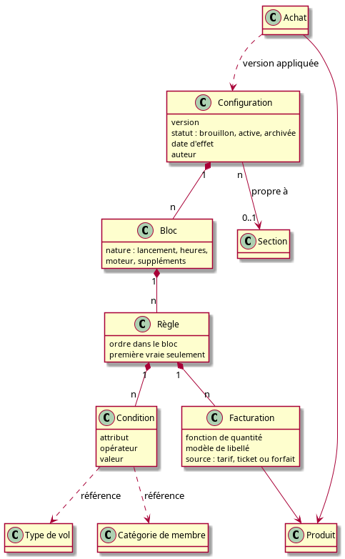
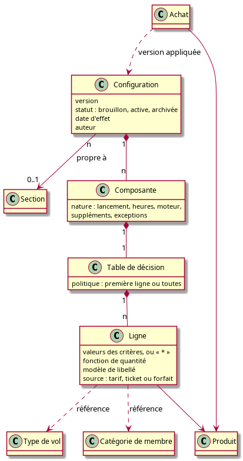
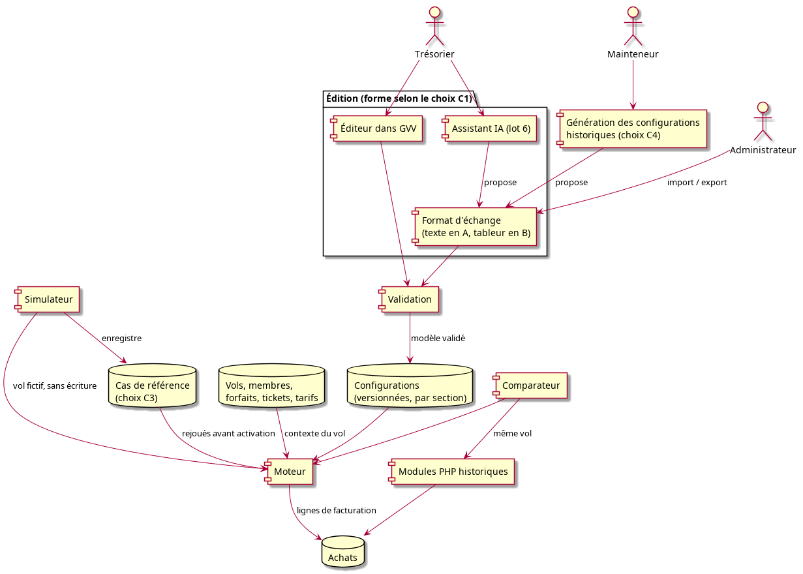

# Conception : Configuration de la facturation

*Statut : document de consultation — 2026-11-26. Plusieurs choix restent ouverts (§2). Ils seront tranchés au lot 3, après l'avis des trésoriers et l'analyse détaillée des modules de facturation existants.*

Exigences : [configuration_facturation_prd.md](../prds/configuration_facturation_prd.md)

## 1. Problème de conception

Il faut remplacer les modules PHP de club (`application/libraries/Facturation_<club>.php`) par une configuration modifiable depuis l'interface. Cette configuration doit être :

* aussi expressive que les modules existants, pour que les résultats soient identiques à l'euro et au libellé près (EF19) ;
* compréhensible par un trésorier qui n'a jamais programmé (EF7) ;
* incapable d'exécuter du code (ENF1).

Ces trois contraintes tirent dans des directions opposées. Le choix d'architecture consiste à trouver le point d'équilibre.

**Constat sur l'existant.** Les modules de club ont tous le même squelette, par exemple `Facturation_accabs.php` dans `facture_vol_planeur()`, et de même Vichy, CPTA, ULM et DAC. Chacun facture successivement :

1. le lancement (remorqué selon la hauteur, ou treuillée) ;
2. les heures de vol (tarif de la machine, plafond, forfait) ;
3. le temps moteur.

Il applique ensuite des exceptions selon le type de vol et la catégorie du pilote. Les clubs diffèrent par le contenu de ces étapes, beaucoup moins par leur enchaînement. Ce constat pèse sur le choix C1 (§2.1). Il sera vérifié au lot 3 sur l'ensemble des modules.

## 2. Choix ouverts

| Choix | Options | Recommandation | Avis attendu |
| :--- | :--- | :--- | :--- |
| C1 – Forme de la configuration | A : règles libres et langage texte · B : composantes fixes et tables de décision | B | Trésoriers (lisibilité), mainteneurs (couverture des modules) |
| C2 – Réductions par catégorie | Produits distincts par catégorie · Prix du produit variant selon la catégorie | À trancher au lot 3 | Trésoriers |
| C3 – Cas de référence tenus par le trésorier | Oui · Non | Oui | Trésoriers |
| C4 – Génération des configurations historiques | Traduction des modules · Déduction à partir de l'historique · Les deux | Les deux | Mainteneurs |

### 2.1 C1 – Forme de la configuration

#### Option A : règles libres et langage texte (DSL)

Une configuration est découpée en blocs (lancement, heures de vol, moteur, suppléments). Chaque bloc est une suite de règles « si … sinon si … alors … » dont seule la première vraie s'applique, et tous les blocs s'appliquent l'un après l'autre. Le modèle a deux représentations équivalentes :

* une interface graphique, où chaque règle est construite avec des sélecteurs ;
* un texte en français, modifiable directement, qui sert aussi à l'import et à l'export.

La syntaxe et les mots-clés envisagés sont décrits en annexe A du PRD, avec la traduction complète du module ACCABS. Extrait :

```
lancement :
  si offert : rien
  sinon si lancement est treuil :
    facturer 1 "Treuillé" libellé " à {heure}{mention}"
  sinon si lancement est remorqué :
    décompter 1 ticket "Remorqué", sinon facturer 1 "Remorqué 500m"
```



* Avantages : c'est l'option la plus expressive, et elle n'impose aucune structure à la facturation d'un club. Le texte se prête bien à la comparaison entre versions et à la production par un agent IA.
* Inconvénients :
  * le trésorier doit raisonner en règles enchaînées : l'ordre des règles crée des interactions difficiles à voir ;
  * on ne peut pas vérifier automatiquement qu'un cas n'est couvert par aucune règle, ou par deux règles contradictoires ;
  * il faut concevoir, documenter et maintenir une grammaire et son analyseur, dans un langage qu'aucun trésorier n'aura rencontré ailleurs.

#### Option B : composantes fixes et tables de décision (recommandée)

La structure de la facturation est fixée par GVV : lancement, heures de vol, temps moteur, suppléments, exceptions. Le trésorier configure le contenu de chaque **composante**, sous la forme d'une **table de décision**, c'est-à-dire une grille tarifaire :

| Type de vol | Catégorie | Machine | Hauteur | → Produit | Quantité |
| :--- | :--- | :--- | :--- | :--- | :--- |
| Découverte | * | * | * | *(rien)* | — |
| * | -25 ans | * | ≤ 500 m | Remorqué 500 m -25 ans | 1 |
| * | * | * | ≤ 500 m | Remorqué 500 m | 1 |

Chaque table a une **politique d'application** explicite : « première ligne qui correspond » ou « toutes les lignes qui correspondent ». Cette sémantique est reprise de la norme DMN (Decision Model and Notation), sans l'implémenter.



* Avantages :
  * c'est la forme sous laquelle les clubs publient déjà leurs tarifs ;
  * GVV peut **signaler automatiquement les trous et les chevauchements** : un cas qu'aucune ligne ne couvre, ou que deux lignes couvrent avec des résultats différents. C'est la principale source d'ambiguïté d'une configuration (EF8) ;
  * il n'y a pas d'interactions cachées : chaque composante se lit indépendamment des autres ;
  * l'import et l'export se font en tableur (CSV ou xlsx, que GVV produit déjà). Le trésorier peut préparer sa grille dans LibreOffice. Il n'y a ni grammaire ni analyseur de texte à écrire.
* Inconvénients :
  * un besoin qui ne rentre dans aucune composante oblige à faire évoluer GVV : une colonne ou une composante de plus, ajoutée pour tous les clubs ;
  * c'est moins compact qu'un texte quand une exception touche plusieurs composantes, par exemple « vol d'essai : rien n'est facturé » doit figurer dans chaque table concernée.

**Pourquoi B est recommandée** : le constat du §1 indique que la souplesse supplémentaire de A ne sert pas aux clubs actuels, alors que sa difficulté est payée par chaque trésorier. Si l'analyse du lot 3 trouvait un module qui ne rentre pas dans des composantes, la question serait rouverte.

#### Couverture de l'inventaire des modules existants

Le PRD (§1.4) dresse l'inventaire des informations et des effets utilisés par les sept modules actuels. Chacun doit pouvoir être exprimé, faute de quoi la reprise à l'identique (EF19) serait impossible.

* **Option A** : tout est couvert. Le langage a la même puissance que les modules sur ce périmètre, avec une autre syntaxe : conditions, choix de produit, quantités calculées et effets. Il ne lui manque que ce qui n'est pas nécessaire (boucles, variables modifiables, accès libre aux données). Le vocabulaire est donné en annexe A du PRD.
* **Option B** : tout est couvert, à condition que la liste fermée des fonctions de quantité et des modes de paiement contienne les éléments marqués ci-dessous. Aucun élément n'exige de code propre à un club.

| Élément de l'inventaire | Option A (texte) | Option B (grilles) |
| :--- | :--- | :--- |
| Critères simples du vol, de la machine et du pilote (type de vol, lancement, terrain, DC, privée, catégorie, âge, passagers, ticket collé…) | condition `si` | colonne de critère |
| Hauteur par seuils (300 m, 500 m, demi-remorqué) | `hauteur ≤ 350 m` | colonne avec intervalles |
| Produit choisi machine par machine (ACES, Vichy) | `selon machine, … :` | colonne « Machine » : c'est la forme naturelle d'une grille |
| Produit -25 ans s'il a un tarif, sinon produit normal | `ou à défaut` | colonne « À défaut » |
| Nom de produit construit à partir de la hauteur (DAC) | une ligne par hauteur avec `selon hauteur` | une ligne par hauteur |
| Durée, moitié, plafond, franchise | quantités `plafonnée à`, `au-delà de`, `moitié de` | fonctions de quantité paramétrées |
| Barème dégressif de durée (ACES) | `barème de durée` | **fonction « barème »**, paramétrée par une petite grille de paliers |
| Tranches de 100 m au-delà de 500 m | `nombre de tranches de … au-delà de …` | **fonction « tranches »** |
| Tarif dégressif selon les heures cumulées dans l'année (Vichy) | critère `heures du pilote sur la machine dans l'année` | même critère en colonne |
| Forfait acheté dans l'année | `a acheté "…" dans l'année du vol` | colonne de critère |
| Forfait de N heures consommé puis reste au tarif (CPTA, ACES) | `consommer le forfait … puis` | **mode de paiement « forfait puis tarif »** |
| Ticket décompté, sinon facturé | `décompter …, sinon` | mode de paiement « ticket, sinon tarif » |
| 7 tickets échangés contre une treuillée (Vichy) | `décompter 7 tickets …, sinon` | mode de paiement « N tickets, sinon tarif » |
| Ligne facturée au compte d'un tiers | `au compte "…"` | colonne « Facturé à » |
| Crédit d'un ticket au treuillard | `créditer … au treuillard` | **composante « Crédits »** : une grille dont les lignes créditent au lieu de facturer |
| Ligne à quantité nulle conservée comme trace | `facturer 0 …` | quantité 0 autorisée |
| Libellés variables, dans la langue du club | `libellé "…{heure}…"` | colonne « Libellé » avec les mêmes éléments variables |
| Partage avec le payeur, compte d'un parent, tarif à la date | appliqués par le moteur, hors configuration | idem |

Les anomalies relevées dans le PRD (§1.4) se reproduisent de la même façon dans les deux options : par exemple, l'année du forfait est un paramètre du critère « a acheté », qui peut valoir « année du vol » ou « année en cours ». La décision de les reproduire ou non relève du PRD (§9.2, choix 4).

Le moteur doit aussi pouvoir créditer des tickets, pas seulement produire des lignes de facturation. ENF1 est respectée tant que ces crédits passent par le même moteur et restent limités aux tickets.

#### Éléments communs aux deux options

* Les critères disponibles forment une liste fermée :
  * vol : durée, lancement, hauteur ou durée de remorqué, type de vol, double commande, site de décollage ;
  * machine : type, privée, propriétaire, et tarifs propres à la machine ;
  * pilote : catégorie, âge à la date du vol, forfait valide, tickets disponibles. La catégorie est affectée par le trésorier ; l'âge est calculé à partir de la date de naissance. Les deux coexistent parce que les clubs n'ont pas la même pratique pour le tarif moins de 25 ans (EF20a).
* Les fonctions de quantité forment elles aussi une liste fermée : fixe, proportionnelle à la durée avec coefficient, plafonnée (seuil et franchise), par tranches pour la hauteur de remorqué.
* Chaque ligne facturée a un modèle de libellé et une source : tarif simple, ticket décompté s'il y en a un sinon tarif, ou forfait.
* Il n'y a ni boucles, ni variables, ni fonctions définies par l'utilisateur. L'évaluation se termine toujours et ne peut rien faire d'autre que produire des lignes de facturation (ENF1). Un format importé (texte en A, tableur en B) est toujours traduit vers le modèle et validé ; il n'est jamais exécuté.
* Une condition désigne un type de vol par son nom et son domaine (planeur ou avion), jamais par un numéro. La validation refuse un type planeur dans une configuration avion.

### 2.2 C2 – Réductions par catégorie

* **Produits distincts** (situation actuelle) : une réduction est un autre produit, par exemple « Remorqué 500m -25ans » dans `Facturation_ulm.php`. La configuration choisit le produit selon la catégorie.
  * Avantages : rien ne change dans les tarifs, et les libellés historiques sont conservés d'office.
  * Inconvénient : les tables, ou les règles, ont autant de lignes que de couples produit × catégorie.
* **Prix variant selon la catégorie** : le prix d'un produit dépend de la catégorie du membre, comme il dépend déjà de la date.
  * Avantage : une réduction devient une affaire de prix et non de configuration, ce qui divise environ par deux la taille de la configuration.
  * Inconvénients : il faut modifier les tarifs, qui servent aussi en dehors de la facturation des vols. Et il faut reprendre les produits en double existants en conservant leurs libellés (EF19).

### 2.3 C3 – Cas de référence tenus par le trésorier

Depuis le simulateur, le trésorier enregistre un **cas de référence** : un vol type avec les lignes de facturation qu'il attend. Avant l'activation d'une nouvelle version de la configuration, GVV rejoue tous les cas et signale chaque écart.

* Pour un trésorier, c'est l'équivalent d'une suite de tests de non-régression. Ça répond à la difficulté de tester une configuration, quelle que soit l'option retenue en C1.
* Les cas de référence d'un club peuvent être produits automatiquement à partir de son historique (C4).
* Avec un agent IA (lot 6), chaque réponse du trésorier peut devenir un cas de référence : la proposition de l'agent est alors jugée sur des exemples vérifiables.
* Coût : un écran et une table de plus, et le moteur de rejeu est le même que celui du comparateur (§3.6).

### 2.4 C4 – Génération des configurations historiques

Le PRD demande qu'une configuration soit générée automatiquement pour chaque module historique (EF18).

* **Traduction des modules** : un mainteneur, assisté d'un outil d'IA de code, traduit chaque module PHP vers le modèle retenu.
  * Avantage : on suit fidèlement la logique du module, y compris dans des cas rares.
  * Inconvénient : le travail est manuel pour chaque club, et le résultat n'est fiable qu'après comparaison.
* **Déduction à partir de l'historique** : chaque club a des milliers de vols déjà facturés. Un outil propose une configuration qui reproduit ces exemples, puis la vérifie contre eux.
  * Avantages : c'est automatique, et la vérification porte sur les données réelles du club.
  * Inconvénient : un cas qui n'est jamais arrivé ne peut pas être déduit.
* **Les deux** (recommandé) : on traduit le module pour la logique, et l'historique sert de juge (§3.6). C'est aussi un premier usage de l'IA, au service des mainteneurs, bien avant le lot 6.

### 2.5 Options écartées

| Option | Raison |
| :--- | :--- |
| Statu quo : un module PHP par club | C'est le problème à résoudre : il faut un informaticien et un accès au serveur, et le comportement des clubs reste codé en dur. |
| Chargement de modules PHP depuis l'interface | Il faut toujours savoir écrire du PHP. Surtout, un accès même temporaire à un compte trésorier ou administrateur suffirait pour exécuter du code arbitraire : effacer la base, ou y introduire des incohérences difficiles à détecter. Contredit ENF1. |
| Modules PHP avec de meilleurs outils (bibliothèque de briques, tests par club, déploiement par git) | Avec un assistant de code, écrire un module coûte moins cher qu'avant, mais le trésorier reste dépendant d'un développeur. C'est le coût de référence : la solution retenue doit être nettement plus simple pour le trésorier. |
| Langage de script embarqué (Lua, JavaScript) | Il faut une extension PHP (ext-lua, v8js) qu'on ne trouve pas sur les hébergements des clubs, et il faut toujours savoir programmer. |
| Moteur d'expressions tiers (JSONLogic, Symfony ExpressionLanguage) | Le format est fait pour des développeurs, GVV n'utilise pas Composer, et ces moteurs ne savent rien des produits, des tarifs datés, des tickets ni des forfaits, qui forment l'essentiel du travail. |
| Interface graphique seule, sans format d'échange | On ne pourrait ni exporter (EF16), ni comparer deux versions, ni faire produire une configuration par un outil ou un agent. |
| Tableur comme seule interface | Sans écran dans GVV, on perd la validation au fil de la saisie et la gestion des versions. Le tableur reste un format d'échange dans l'option B. |

### 2.6 Agent IA (lot 6)

Un agent dialogue avec le trésorier, lui pose des questions en cas de doute ou d'ambiguïté, et rédige la configuration (CU6). Les trésoriers savent précisément ce qu'ils veulent, même quand ils ont du mal à le formaliser. Interrogés en langage naturel, ils répondront très probablement avec précision.

C'est un complément, pas une fondation. Une IA est non déterministe, dépend d'un service externe et peut se tromper. Elle n'est sûre que si :

* elle produit une configuration dans le format d'échange du modèle retenu : texte en option A, tableau en option B ;
* cette configuration passe par la même validation, le même simulateur et, si C3 est retenu, les mêmes cas de référence qu'une saisie humaine ;
* c'est un humain qui l'active.

L'agent fonctionne avec l'une ou l'autre option de C1.

## 3. Architecture commune

Ces éléments ne dépendent pas des choix ouverts.



### 3.1 Versions, dates d'effet et sections

Chaque version d'une configuration est conservée, avec son statut (brouillon, active, archivée), son auteur et sa **date d'effet** (EF9, EF10, EF10a). Une configuration est **commune** au club ou propre à une **section** (EF10b). Pour un vol, le moteur retient la configuration de la section du vol en vigueur à la date du vol, et à défaut la configuration commune.

### 3.2 Moteur

Le moteur ne remplace que la **décision**, c'est-à-dire quoi facturer et combien. Il réutilise les primitives communes de la classe `Facturation` existante : création d'un achat au tarif en vigueur à la date du vol, partage avec un payeur (EF6), décompte de ticket, annulation de la facturation d'un vol. Les montants restent donc calculés comme aujourd'hui.

Le moteur a un mode « sans écriture », où les lignes sont collectées au lieu d'être enregistrées. Chaque achat qu'il produit enregistre la version de configuration appliquée.

### 3.3 Simulateur

Le simulateur appelle le moteur en mode sans écriture sur un vol fictif. Il peut viser une configuration en brouillon (EF11, EF12). Le formulaire reprend la saisie de vol planeur ou avion, avec en plus les forfaits et les tickets du pilote.

### 3.4 Types de vol et catégories de membre

Ils passent de `config/program.php` à des tables de référence gérées depuis l'interface. Les types planeur et avion restent deux listes distinctes : le même numéro n'y a pas le même sens (3 = Concours en planeur, Remorquage en avion). Les identifiants existants sont conservés dans chaque domaine, pour que les vols et les membres restent valides sans migration de données.

Le code qui teste aujourd'hui une valeur en dur s'appuie désormais sur un **rôle système** porté par le type, et non sur son identifiant (EF15). Les tests concernés sont :

* le vol d'essai modifiable par un mécanicien ;
* le vol de découverte ;
* le remorquage avion, reconnu aujourd'hui par coïncidence avec la constante de lancement `REM` ;
* le vol propriétaire (`4` en dur) ;
* les vols porte ouverte et BIA.

La suppression d'un type ou d'une catégorie déjà utilisé est refusée (EF14). Le contrôle porte sur les membres, les vols, toutes les versions de configuration et les achats. Pour ne plus proposer un élément qui ne sert plus, le trésorier le désactive : il disparaît des sélecteurs et reste lisible dans l'historique.

### 3.5 Coexistence et bascule

La bascule est une **date**, et non un simple interrupteur : c'est la date d'effet de la première configuration du club. Un vol antérieur à cette date est facturé, et refacturé, par le module historique ; un vol postérieur l'est par le moteur (EF21, EF22). Un vol ne change donc jamais de mécanisme, et la date peut être alignée sur une date de gel existante pour qu'aucun vol de la période ouverte ne soit concerné.

Les modules historiques restent en place tant qu'ils servent aux vols antérieurs à la bascule. Ils restent aussi en place pour la facturation du carburant, qui est hors périmètre.

### 3.6 Non-régression

Le **comparateur** refacture en mode sans écriture tous les vols d'un déploiement, une fois avec le module historique et une fois avec la configuration générée (C4). Il compare ensuite produits, quantités, montants, libellés et payeurs, et liste chaque écart.

Une configuration de club n'est activée qu'avec un écart nul sur l'historique complet du club (EF19, critère d'acceptation 1). Pour cela, les modules historiques doivent eux aussi pouvoir s'exécuter sans écrire : c'est la seule modification à leur apporter.

Les catégories affectées aux membres lors de la reprise (EF20) sont déduites de ce que les modules historiques testent aujourd'hui. Le comparateur vérifie qu'elles sont correctes.

## 4. Risques

* **Expressivité** : un module historique peut contenir un cas que le modèle ne sait pas exprimer. On le découvrira au comparateur. La réponse est d'ajouter un critère, une fonction de quantité ou une composante à la liste fermée, jamais une échappatoire vers du code.
* **Libellés** : les libellés historiques sont parfois construits de façon ad hoc. Les modèles de libellé doivent offrir assez d'éléments variables pour les reproduire à l'identique.
* **Complexité perçue** : la configuration doit rester lisible pour le club le plus complexe. Ce point est à valider sur la plus complexe des configurations reprises, quelle que soit l'option C1.

## 5. Découpage en lots

| Lot | Composants de cette conception |
| :--- | :--- |
| 1 | Table des catégories de membre (§3.4) et catégorie de facturation du membre, qui remplace la case à cocher « moins de 25 ans ». Seul le module qui lit cette case est modifié ; les modules qui calculent l'âge ne changent pas |
| 2 | Table des types de vol et rôles système (§3.4) |
| 3 | Analyse des modules existants (composantes, critères, fonctions de quantité, formes de libellé) ; décision sur C1 à C4 après avis des trésoriers |
| 4 | Modèle retenu en C1, éditeur et format d'échange, moteur en mode sans écriture, simulateur, cas de référence si C3 est retenu (§2.1 à §2.3, §3.1 à §3.3) |
| 5 | Moteur en écriture, date de bascule, génération des configurations historiques et comparateur (§2.4, §3.5, §3.6) |
| 6 | Agent IA (§2.6) |

Les lots 1 et 2 obligent les modules historiques à lire les catégories et les types dans les nouvelles tables. Le comparateur du §3.6 est donc utile dès ces lots pour vérifier qu'ils ne changent aucune facturation.
