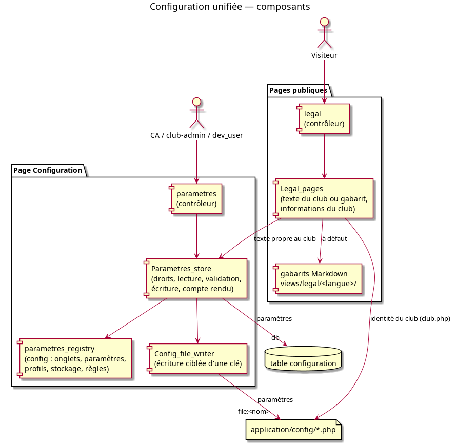

# Note de conception : Configuration unifiée

**PRD :** `doc/prds/configuration_unifiee_prd.md` — **Plan :** `doc/plans/configuration_unifiee_plan.md`

## Principe

La page Configuration est générée à partir d'un **registre déclaratif** : un tableau qui décrit chaque paramètre (onglet, stockage, type, profils, règles). Pour ajouter un paramètre, on ajoute une entrée au registre, sans écrire d'écran. Un seul composant, `Parametres_store`, sait où se trouve chaque paramètre. Le contrôleur et les vues ne voient que des clés et des valeurs.



## Composants

| Composant | Responsabilité |
| :--- | :--- |
| `config/parametres_registry.php` | Déclaration des onglets et des paramètres. Tableau PHP sans dépendance au reste de l'application. |
| `libraries/Parametres_store` | Rang de l'utilisateur ; onglets visibles ; droits de lecture et d'écriture ; lecture de la valeur en vigueur (avec indication « valeur par défaut ») ; validation ; écriture dans le bon support ; compte rendu par paramètre. |
| `libraries/Config_file_writer` | Lecture et écriture d'**une** clé d'un fichier `application/config/<nom>.php`, sans toucher au reste du fichier. Vérifie la syntaxe du résultat avant d'écrire. |
| `controllers/parametres` | Affiche un onglet, enregistre un onglet, refuse explicitement un onglet non autorisé. |
| `libraries/Legal_pages`, `controllers/legal` | Pages publiques : texte propre au club ou gabarit générique, avec insertion des informations du club. |

## Profils

Les profils sont ordonnés : CA (1) < club-admin (2) < dev_user (3). Le rang d'un utilisateur est le plus élevé de ses profils. Chaque paramètre déclare un profil minimal de lecture et un profil minimal de modification. Un onglet est visible dès qu'un de ses paramètres est lisible, et modifiable dès qu'un de ses paramètres est modifiable.

- CA et club-admin sont des rôles GVV, tous sections confondues (`has_global_role`).
- dev_user est un utilisateur listé dans `program.php` (`dev_users`), vérifié par le helper `is_dev_user()`.

## Stockage

| Valeur de `store` | Support | Variantes |
| :--- | :--- | :--- |
| `db` | Table `configuration` (`cle`, `valeur`, `lang`, `club`) | Par langue (`lang`). Les variantes par section (`club`) arrivent au lot 3. Une valeur vide supprime la ligne : le paramètre revient à sa valeur par défaut. |
| `file:<nom>` | Clé `$config['…']` de `application/config/<nom>.php` | Aucune |

La migration 184 passe `configuration.valeur` en `TEXT`, pour les textes longs, et ajoute les champs d'audit. `updated_at` sert aussi de date de mise à jour sur les pages publiques.

La lecture par langue n'utilise pas `Configuration_model::get_param()`. Quand une seule ligne existe, cette méthode la rend quelle que soit sa langue. `Parametres_store` cherche la langue exacte, puis se replie explicitement sur le français.

## Pages publiques

```
texte propre au club (langue demandée → français)
        └─ à défaut : gabarit views/legal/<langue>/<page>.md (→ français)
              └─ blocs [[si <condition>]] … [[fin]] retirés si la condition est fausse
                    └─ {nom_club}, {email_club}, … remplacés par les valeurs de club.php
                          └─ Markdown → HTML (Parsedown, mode sûr)
```

Conditions disponibles :
- `paiements` : HelloAsso est activé dans au moins une section ;
- `site` : le site web du club est renseigné ;
- `telephone` : le téléphone du club est renseigné.

Le contact RGPD (`contact_rgpd`, dans `club.php`) vaut « le président de l'association » quand il est vide.

## Choix et limites

- **`Config_file_writer` plutôt que `config.php::saveConfig()`.** L'ancienne méthode réécrit tout le fichier `club.php` à partir de sa propre liste de champs, et n'échappe pas `$`. Le nouvel écrivain reprend la méthode ciblée de l'installeur, en corrigeant deux points : une valeur n'est plus interprétée comme référence arrière, et une clé ajoutée est placée avant une éventuelle balise `?>` finale. L'écran `config` garde sa méthode jusqu'à son remplacement par l'onglet Club (lot 2).
- **Entrée de menu.** Elle reste dans le sous-menu « Club », visible seulement du CA : ce sous-menu contient d'autres écrans réservés au CA. Un dev_user qui n'est pas membre du CA accède à la page par la tuile du tableau de bord « Administration du club ».
- **Jeton anti-CSRF propre à la page.** La protection CSRF globale de CodeIgniter est désactivée dans GVV. L'enregistrement d'un onglet exige donc un jeton aléatoire conservé en session et envoyé par le formulaire. Une demande sans jeton valide n'enregistre rien et affiche un message.
- **Pages publiques et acceptations obligatoires.** `legal`, `newsletter` et `newsletter_public` sont exemptés du blocage par acceptation obligatoire de `MY_Controller`. Un membre qui doit accepter le document RGPD peut ainsi lire les règles de confidentialité.
- **Rang de l'utilisateur mémorisé.** Il est calculé une fois par requête. La page Configuration et l'entrée de menu, affichée sur toutes les pages, n'interrogent les autorisations qu'une fois.
