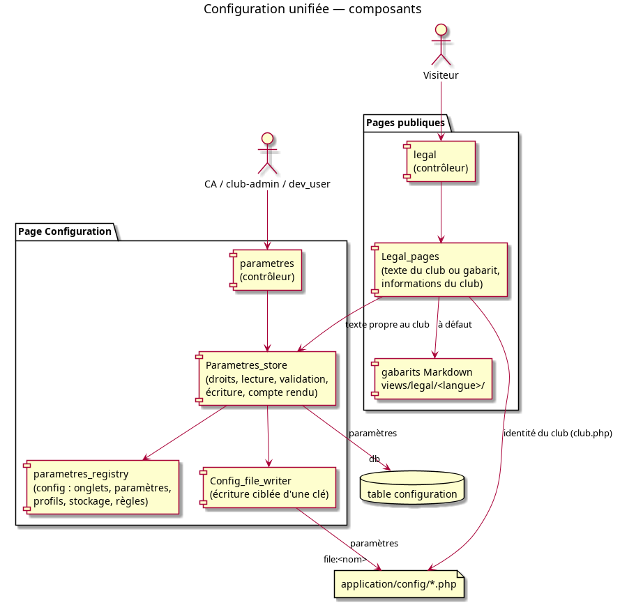

# Note de conception : Configuration unifiée

**PRD :** `doc/prds/configuration_unifiee_prd.md` — **Plan :** `doc/plans/configuration_unifiee_plan.md`

## Principe

La page Configuration est générée à partir d'un **registre déclaratif** : un tableau qui décrit chaque paramètre (onglet, stockage, type, profils, règles). Pour ajouter un paramètre, on ajoute une entrée au registre, sans écrire d'écran. Un seul composant, `Parametres_store`, sait où se trouve chaque paramètre. Le contrôleur et les vues ne voient que des clés et des valeurs.



## Composants

| Composant | Responsabilité |
| :--- | :--- |
| `config/parametres_registry.php` | Déclaration des onglets et des paramètres. Tableau PHP sans dépendance au reste de l'application. |
| `libraries/Parametres_store` | Rang de l'utilisateur ; onglets visibles ; droits de lecture et d'écriture ; lecture de la valeur en vigueur (avec indication « valeur par défaut ») ; validation ; écriture dans le bon support ; compte rendu par paramètre. |
| `models/Parametres_history_model` | Trace de chaque écriture dans `parametres_history` ; lecture de l'historique d'un onglet. |
| `libraries/Config_file_writer` | Lecture et écriture d'**une** clé d'un fichier `application/config/<nom>.php`, sans toucher au reste du fichier. Vérifie la syntaxe du résultat avant d'écrire. Crée un fichier absent avec le seul en-tête CodeIgniter, jamais depuis son modèle `*.example.php`, dont les valeurs d'exemple changeraient le comportement de GVV. |
| `controllers/parametres` | Affiche un onglet, enregistre un onglet, refuse explicitement un onglet non autorisé ; historique d'un onglet, retour arrière ; e-mail de test (onglet Messagerie). |
| `libraries/Legal_pages`, `controllers/legal` | Pages publiques : texte propre au club ou gabarit générique, avec insertion des informations du club. |

## Profils

Les profils sont ordonnés : CA (1) < club-admin (2) < dev_user (3). Le rang d'un utilisateur est le plus élevé de ses profils. Chaque paramètre déclare un profil minimal de lecture et un profil minimal de modification. Un onglet est visible dès qu'un de ses paramètres est lisible, et modifiable dès qu'un de ses paramètres est modifiable.

- CA et club-admin sont des rôles GVV, tous sections confondues (`has_global_role`).
- dev_user est un utilisateur listé dans `program.php` (`dev_users`), vérifié par le helper `is_dev_user()`.

## Stockage

| Valeur de `store` | Support | Variantes |
| :--- | :--- | :--- |
| `db` | Table `configuration` (`cle`, `valeur`, `lang`, `club`) | Par langue (`lang`). Pas de variante par section (reportée, PRD §10). Une valeur vide supprime la ligne : le paramètre revient à sa valeur par défaut. |
| `file:<nom>` | Clé `$config['…']` de `application/config/<nom>.php` | Aucune |
| `info:<nom>` | Information d'installation calculée (URL, base de données, version, migration) | Lecture seule (`write => 'none'`) |

La migration 184 passe `configuration.valeur` en `TEXT`, pour les textes longs, et ajoute les champs d'audit. `updated_at` sert aussi de date de mise à jour sur les pages publiques.

La lecture par langue n'utilise pas `Configuration_model::get_param()`. Quand une seule ligne existe, cette méthode la rend quelle que soit sa langue. `Parametres_store` cherche la langue exacte, puis se replie explicitement sur le français.

## Déclaration d'un paramètre

Outre son onglet, son stockage, son type et ses profils, un paramètre peut déclarer :
- `secret` : la valeur n'est jamais réaffichée ni tracée. Un champ laissé vide conserve la valeur ; l'effacer demande une case explicite.
- `required` ou `required_if` : obligatoire toujours, ou seulement quand d'autres paramètres ont une valeur donnée (le serveur SMTP en mode SMTP). Le contrôle porte sur la valeur enregistrée de l'autre paramètre : le registre déclare donc celui-ci avant.
- `requires` (modules) : paramètres dont le module a besoin. Le module s'active toujours ; tant qu'il est actif et qu'un de ces paramètres manque, l'onglet Modules désigne l'onglet à compléter.
- types `select` (liste `options`, ou `options_source` calculée : thèmes installés, modules de facturation, comptes de recettes, produits) et `image` (fichier déposé dans `uploads/`, seule façon de changer la valeur).
- `group` : intertitre regroupant des paramètres consécutifs d'un onglet chargé (Finances, Newsletter, Système).
- `as_string` : valeur écrite entre guillemets, booléen en `'1'` ou `''`. Nécessaire pour `newsletter.php`, que la newsletter lit par expression régulière et non par `include`.
- `encoding => 'base64'` : secret enregistré encodé, comme l'attend la newsletter.
- `write => 'none'` : affiché en lecture seule pour tous (règles de `facturation.php`, fichier suivi par git ; informations d'installation). Ces paramètres n'entrent pas dans l'état de l'onglet.

## Liens d'onglet

Un onglet peut déclarer des `links` : écrans spécialisés existants (réglages HelloAsso par section, mise en page des cartes, types de documents, formulaires, listes de référence, tests de la newsletter et des SMS). Chaque lien a un profil minimal et, au besoin, un module qui doit être actif. Un onglet est visible s'il a un paramètre lisible ou un lien accessible ; un onglet sans paramètre n'a pas d'état. Ces écrans gardent leur adresse et leur logique : la page Configuration est leur point d'entrée, pas leur remplaçant (PRD EX-PRO-07).

## Transition

`config` et `newsletter_admin/configuration` redirigent vers leur onglet ; `configuration` ne redirige que sa liste, vers l'onglet Système, qui affiche les clés non déclarées dans le registre : la création et la modification d'une clé restent dans l'ancien éditeur (réglages propres à un écran, comme la mise en page des cartes).

Un paramètre obligatoire dont GVV fournit une valeur par défaut non vide n'est jamais « manquant » : l'onglet n'est pas signalé incomplet tant que cette valeur convient.

Un paramètre que l'utilisateur peut lire sans pouvoir le modifier est affiché comme une valeur, jamais comme un champ, et l'onglet sans paramètre modifiable n'a pas de bouton d'enregistrement.

## Historique

`Parametres_store::save()` trace chaque enregistrement effectif (pas les valeurs inchangées) : paramètre, onglet, langue, ancienne et nouvelle valeur, action (`modification`, `effacement` d'un secret, `retour`), auteur et date. Une ancienne valeur `NULL` signifie « non défini » ; pour un secret, les deux valeurs sont toujours `NULL`.

Le retour arrière relit l'ancienne valeur d'une ligne et la renvoie à `save()` : elle est donc revalidée, soumise aux droits d'écriture, et tracée comme `retour`. « Non défini » redevient la valeur par défaut (ligne supprimée en base, valeur par défaut du registre dans un fichier). Les secrets ne se restaurent pas.

L'historique d'un onglet est réservé aux profils qui peuvent le modifier. Il est affiché par `gvvmetadata->table()` sur des lignes préparées par le contrôleur (valeurs échappées, bouton de retour en POST avec le jeton de la page).

Un logo remplacé n'est pas supprimé du serveur, pour que le retour arrière reste possible.

## Pages publiques

```
texte propre au club (langue demandée → français)
        └─ à défaut : gabarit views/legal/<langue>/<page>.md (→ français)
              └─ blocs [[si <condition>]] … [[fin]] retirés si la condition est fausse
                    └─ {nom_club}, {email_club}, … remplacés par les valeurs de club.php
                          └─ Markdown → HTML (Parsedown, mode sûr)
```

Conditions disponibles :
- `paiements` : HelloAsso est activé dans au moins une section ;
- `site` : le site web du club est renseigné ;
- `telephone` : le téléphone du club est renseigné.

Le contact RGPD (`contact_rgpd`, dans `club.php`) vaut « le président de l'association » quand il est vide.

## Choix et limites

- **`Config_file_writer` plutôt que `config.php::saveConfig()`.** L'ancienne méthode réécrivait tout le fichier `club.php` à partir de sa propre liste de champs, et n'échappait pas `$`. Le nouvel écrivain reprend la méthode ciblée de l'installeur, en corrigeant deux points : une valeur n'est plus interprétée comme référence arrière, et une clé ajoutée est placée avant une éventuelle balise `?>` finale. Depuis le lot 2, l'écran `config` ne modifie plus l'identité du club, qui n'a ainsi qu'un chemin, tracé : l'onglet Club. Il reste en service pour les réglages non encore repris (calendrier Google, FFVV…) et écrit lui aussi clé par clé avec cet écrivain : il ne perd plus les clés qu'il ne connaît pas (contact RGPD, thème…).
- **Formulaire sans validation du navigateur.** Le formulaire désactive la validation HTML5 (`novalidate`) : c'est GVV qui contrôle chaque valeur, et le motif d'un refus s'affiche toujours à côté du champ (EX-ENR-03).
- **E-mail de test.** Il passe par la bibliothèque e-mail de CodeIgniter, qui lit `email.php` : il utilise donc les valeurs enregistrées, et la page le dit (EX-TST-02). Le destinataire proposé est l'utilisateur connecté.
- **Entrée de menu.** Elle reste dans le sous-menu « Club », visible seulement du CA : ce sous-menu contient d'autres écrans réservés au CA. Un dev_user qui n'est pas membre du CA accède à la page par la tuile du tableau de bord « Administration du club ».
- **Jeton anti-CSRF propre à la page.** La protection CSRF globale de CodeIgniter est désactivée dans GVV. L'enregistrement d'un onglet exige donc un jeton aléatoire conservé en session et envoyé par le formulaire. Une demande sans jeton valide n'enregistre rien et affiche un message.
- **Pages publiques et acceptations obligatoires.** `legal`, `newsletter` et `newsletter_public` sont exemptés du blocage par acceptation obligatoire de `MY_Controller`. Un membre qui doit accepter le document RGPD peut ainsi lire les règles de confidentialité.
- **Rang de l'utilisateur mémorisé.** Il est calculé une fois par requête. La page Configuration et l'entrée de menu, affichée sur toutes les pages, n'interrogent les autorisations qu'une fois.
- **Cache de PHP (OPcache).** Un fichier de configuration est lu par `include` : `Config_file_writer` invalide son cache après chaque écriture. Une modification faite hors de GVV (éditeur, script de test) n'est vue qu'après la revalidation d'OPcache ; les tests passent donc par la page pour changer `program.php`.
- **Valeurs mémorisées.** `Parametres_store` mémorise pour la durée de la requête les valeurs lues et le contenu des fichiers de configuration, et vide ce cache à chaque écriture : l'état des onglets, les obligations conditionnelles et les avertissements de modules ne relisent pas les fichiers.
