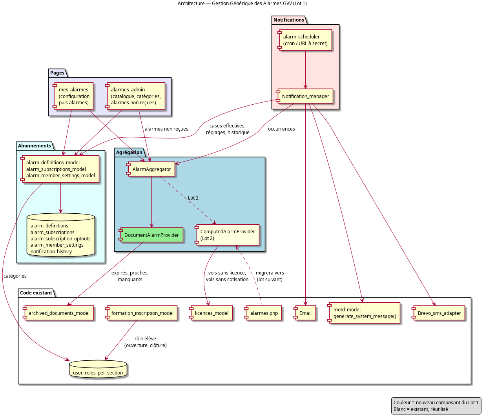
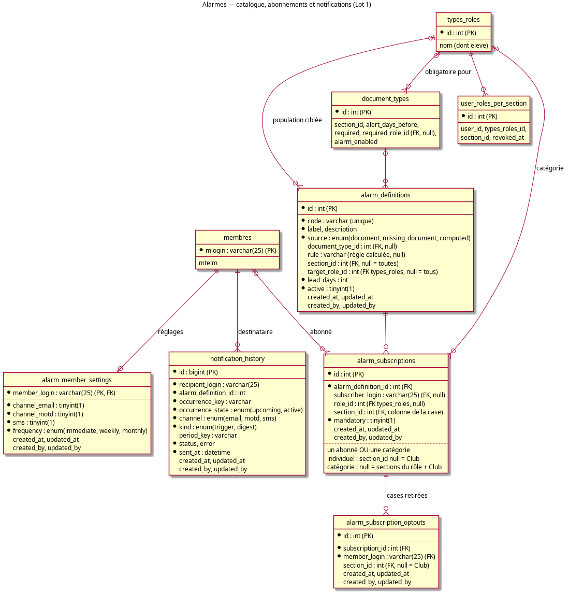
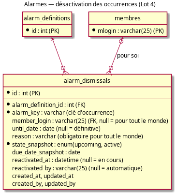

# Design Notes — Gestion Générique des Alarmes

Date : 30 mai 2026 — mis à jour le 18 octobre 2026 (Lot 1 du MVP : alarmes sur les documents archivés, catalogue, abonnements, canaux, synthèses, rôle élève ; reprend les notifications documentaires prévues au Lot 5 de l'archivage documentaire) le 19 octobre 2026 (page unique « Mes alarmes », abonnements par alarme et par section, alarmes propres ; Lot 2 : alarmes calculées de vols sans cotisation et sans licence ; Lot 3 : emport passager, inactivité, compte débiteur) le 20 octobre 2026 (affichage par section active ; Lot 4 : désactivation des occurrences)

## Contexte et objectif

GVV dispose de plusieurs sources d'alarme non unifiées :

- **`archived_documents_model`** : alarmes documentaires basées sur `valid_until`. Statuts : active, expiring_soon, expired, missing.
- **`alarmes.php`** : contrôleur calculant les conditions d'expérience à la volée depuis le carnet de vol (heures, décollages, emport passager, médical, instructeur).
- **`licences_model`** : contrôle des pilotes ayant volé sans cotisation.

L'objectif est d'unifier ces sources sous un contrat commun, sans réécrire les implémentations existantes, et de livrer au Lot 1 :
- un catalogue d'alarmes auxquelles les membres s'abonnent,
- l'envoi des notifications sur les canaux choisis par chaque membre (email, message du jour) et d'un rappel hebdomadaire ou mensuel par SMS,
- les synthèses hebdomadaires et mensuelles,
- la page « Mes alarmes » (liste puis configuration) et la page d'administration.

Document de référence : [gestion_alarmes_generiques_prd.md](../prds/gestion_alarmes_generiques_prd.md). Les notifications documentaires du [PRD d'archivage documentaire](../prds/archivage_documentaire_prd.md) (§10) sont réalisées par ce mécanisme.

---

## Deux familles d'alarmes

| Famille | Source | Stockage | Exemple |
|---------|--------|----------|---------|
| Alarme à date fixe | `archived_documents` | En base — champ `valid_until` | Visite médicale expire le 01/06/2026 |
| Alarme calculée | Carnet de vol, licences | Aucun — évaluée à la demande | Pilote ayant volé sans licence |

Les alarmes calculées ne sont pas stockées en base : elles reflètent l'état courant des données et deviendraient obsolètes dès qu'un vol ou une licence est enregistré. Seules leurs notifications sont historisées.

---

## Architecture



### AlarmItem — structure commune

Toute alarme déclenchée, quelle que soit sa source, est représentée par un `AlarmItem` :

| Champ | Type | Description |
|-------|------|-------------|
| `definition_code` | string | Alarme du catalogue qui l'a produite |
| `key` | string | Identifiant stable de l'occurrence : `document:{id}`, `missing:{type}:{login}`, `computed:{règle}:{login}` |
| `entity_type` | string | `pilot` \| `machine` \| `section` \| `club` |
| `entity_id` | string | Login pilote, immatriculation, etc. |
| `section_ids` | int[] | Sections de rattachement — vide = alarme globale |
| `label` | string | Texte descriptif de l'alarme |
| `state` | string | `upcoming` (à venir) \| `active` |
| `due_date` | date\|null | Échéance — null pour les alarmes calculées sans date fixe |
| `link` | string | Page GVV où traiter l'alarme (superviseur) |
| `link_own` | string | Page GVV où traiter l'alarme quand l'abonné est le membre concerné |

### Providers

Chaque provider traduit une source existante en `AlarmItem[]`, sans modifier le code qu'il lit.

- **`DocumentAlarmProvider`** — lit `archived_documents_model` : expirés et proches de l'expiration (état `upcoming` dans le délai d'anticipation), documents obligatoires manquants. `alarm_disabled = 1` et documents non approuvés sont exclus. Sections d'un document :

  | Portée du document | Sections retenues |
  |---|---|
  | `pilot` | Sections où le pilote détient le rôle `user` (règle « actif par section ») |
  | `section`, `machine` | `archived_documents.section_id`, à défaut `document_types.section_id` |
  | `club` | Aucune — alarme globale |

- **`ComputedAlarmProvider`** (Lots 2 et 3) — alarmes de source `computed`, une règle par alarme (`alarm_definitions.rule`). Lot 2, sur les vols de l'année civile en cours, pilotes extérieurs exclus :

  | Règle | Source | Occurrence (`key`) |
  |---|---|---|
  | `vols_sans_cotisation` | `licences_model::pilotes_vols_sans_cotisation()` : vols sans licence de type 0 pour l'année | `computed:vols_sans_cotisation:{login}:{année}` |
  | `vols_sans_licence` | `licences_model::pilotes_vols_sans_licence()` : vols d'une section sans la licence exigée par la section (`sections.licence_type`) pour l'année | `computed:vols_sans_licence:{login}:{section}:{année}` |

  Une occurrence est toujours `active`, sans échéance. Ses sections sont celles des vols concernés : section des vols planeur pour un vol planeur (`volsp` ne porte pas de section ; `Licences_model::glider_section_id()`, première section `gestion_planeurs`, règle commune à toutes les alarmes), `volsa.club` pour les autres. Aucune section n'est connue du code : la licence exigée est un paramètre de la section (`sections.licence_type`, type de `licences`, vide = aucune), partagé avec la page « Licences par année » ; un remorquage, enregistré dans la section planeur, relève ainsi de la licence planeur. Lien superviseur : page de contrôle des licences (`licences/vols_sans_cotisation`, `licences/per_year`) ; lien du pilote : paiement de la cotisation en ligne pour la cotisation, aucun pour la licence (obtenue hors de GVV).

  Lot 3, par section — vols planeur (`volsp`) pour la section des vols planeur, sans ses remorquages ; vols `volsa` de la section (`club`) pour les autres :

  | Règle | Population | Occurrence (`key`) | Échéance, état |
  |---|---|---|---|
  | `emport_passager` | rôle `emport_passager` non révoqué dans la section | `computed:emport_passager:{login}:{section}` | date du 3ᵉ atterrissage CDB le plus récent + 90 j ; à venir dans `lead_days`, active après (ou sans 3 atterrissages) |
  | `remorquages` | rôle `pilote_rem` non révoqué dans la section des vols planeur | `computed:remorquages:{login}:{section}` | date du 10ᵉ remorqué le plus récent (`volsp.pilote_remorqueur`, un vol planeur = un remorqué) + 12 mois ; à venir dans `lead_days`, active après (ou sans 10 remorqués) |
  | `inactivite` | rôle `user` dans la section, sans rôle `eleve` ; dernier vol dans la section il y a moins de 24 mois | `computed:inactivite:{login}:{section}` | dernier vol + 120 j ; à venir dans `lead_days`, active après |
  | `compte_debiteur` | comptes 411 (`Relances_model::soldes_debiteurs_par_section()`, même calcul que la page des relances, solde du jour seulement) | `computed:compte_debiteur:{login}:{section}` | aucune ; active si le solde de la section est inférieur à −`relances.seuil_alarme` |

  Atterrissage CDB : en planeur, un vol où le pilote est `vppilid` sans double commande (`vpdc = 0`) ou instructeur (`vpinst`) ; en avion et ULM, `vaatt` atterrissages (1 à défaut) des vols où il est `vapilid` sans double commande ou `vainst`. Dernier vol : tout vol où il est pilote ou instructeur. Liens : liste des vols de l'activité (`vols_planeur/page`, `vols_avion/page`) ; pour le compte débiteur, `relances` (superviseur) et `compta/mon_compte/{section}` (pilote). Les seuils (3 atterrissages, 90 jours, 10 remorqués, 12 mois, 120 jours, 24 mois) sont des constantes du fournisseur ; le délai d'anticipation est réglable dans le catalogue. Lots suivants : extraction des autres règles d'`alarmes.php` (médical, expérience récente BPP/SPL, instructeur).

### AlarmAggregator

Service central. Interroge les providers (`DocumentAlarmProvider`, `ComputedAlarmProvider`) pour les alarmes actives du catalogue et renvoie les `AlarmItem` correspondants. Il applique à toutes les sources la même règle de population : une occurrence qui concerne un pilote (`pilot_login`) est supprimée si le pilote est extérieur (`membres.ext`) et ne garde que les sections où il a le rôle `user` non révoqué ; sans section restante, elle est supprimée. Exception : une occurrence marquée `any_pilot` (compte débiteur) n'est pas restreinte aux pilotes actifs, un pilote parti devant encore être relancé. Les occurrences de machine, de section ou de club ne sont pas filtrées.

```php
AlarmAggregator::collect(?array $definitions = null) : AlarmItem[]
```

---

## Lot 1 — Catalogue, abonnements et notifications



### Catalogue

**`alarm_definitions`** : une ligne par alarme proposée aux membres — une par type de document à expiration, pas une par document. Elle porte la source (`document`, `missing_document`, `computed`), le type de document ou la règle calculée visés, la portée (section ou globale), la population ciblée (`target_role_id`, ex. élèves), le délai d'anticipation et l'état actif.

- La migration crée une alarme par type de document à expiration (`document_<id>`), l'alarme des documents manquants (`missing_document`) et celle des visites médicales des élèves (`document_<id>_eleve`, `target_role_id` = `eleve`). La migration du Lot 2 (178) ajoute les alarmes calculées `computed_vols_sans_cotisation` et `computed_vols_sans_licence` ; celle du Lot 3 (179) `computed_emport_passager`, `computed_remorquages`, `computed_inactivite`, `computed_compte_debiteur`, le rôle `emport_passager` (attribué en section planeur aux membres ayant l'événement « Emport passager ») et la colonne `sections.licence_type` (initialisée une fois d'après les acronymes PLA, AVI, ULM).
- `document_types.alarm_enabled` (alarmes possibles, 1 par défaut et pour les types existants) : seul un type actif, à expiration et à alarmes possibles a une alarme. La création ou la modification d'un type crée son alarme ; un type qui n'est plus éligible voit toutes ses alarmes désactivées (y compris celles d'une population), et réactivées s'il le redevient. Une alarme désactivée par un administrateur dans le catalogue reste désactivée.
- Le délai d'anticipation est initialisé depuis `document_types.alert_days_before`.

### Alarmes propres et cases d'abonnement

Un membre reçoit deux sortes d'`AlarmItem` :

- **propres** : ceux dont il est le pilote (`pilot_login`), pour toutes les alarmes actives du catalogue, sans abonnement ni désactivation possible ;
- **par abonnement** : ceux des **cases** auxquelles il est abonné. Une case est un couple (alarme, colonne) ; la colonne est une section, ou **Club** pour les `AlarmItem` sans section (`section_ids` vide). Un `AlarmItem` relève d'une case de section si cette section figure dans ses `section_ids` — pour un document de pilote, les sections où le pilote est actif : la case (certificat médical, avion) ne retient que les pilotes actifs en section avion.

Cases autorisées d'un membre pour une alarme : les sections qu'il peut superviser (cf. Contrôle des droits), restreintes à la section de l'alarme si elle en a une ; la colonne Club s'y ajoute pour une alarme sur des documents qui ne sont pas des documents de pilote (machine, section, club), dès qu'il supervise au moins une section. Une alarme sans case autorisée ne figure pas dans sa matrice.

### Abonnements

- **`alarm_subscriptions`** : un abonnement relie une alarme du catalogue soit à un membre (`subscriber_login`), soit à une catégorie (`role_id` de `types_roles`). `section_id` désigne la colonne : pour un abonnement individuel, la section de la case (NULL = Club) ; pour une catégorie, la section du rôle et de la case (NULL = toutes les sections où le titulaire détient le rôle, plus Club). Il porte un indicateur `mandatory` et les champs d'audit ; `created_by` ≠ abonné signale un abonnement créé par un administrateur.
- **`alarm_subscription_optouts`** : retrait d'un membre d'une case d'un abonnement de catégorie non obligatoire (`section_id`, NULL = Club).
- **`alarm_member_settings`** : réglages par membre, communs à toutes ses alarmes — canaux email et message du jour, rappel SMS, fréquence (`immediate`, `weekly`, `monthly`).

**Cases effectives** d'un membre = cases de ses abonnements individuels ∪ cases des abonnements des catégories dont il détient le rôle, non révoqué (`user_roles_per_section`) − ses retraits, le tout restreint à ses cases autorisées. Elles sont recalculées à chaque usage : un changement de rôle prend effet sans modifier les abonnements.

**Sans abonnement** : le membre a toujours ses alarmes propres sur sa page. Elles ne sont envoyées que s'il a choisi un canal.

**Contrôle des droits** : porte toujours sur l'abonné. Appliqué à la création d'un abonnement et à nouveau à chaque calcul, pour qu'un retrait de rôle prenne effet immédiatement. Mêmes règles de consultation que la liste des documents (`club-admin` toutes sections ; `ca` et `bureau` leurs sections ; types privés réservés au `club-admin` et au bureau). Une alarme ciblant une population (ex. élèves) est aussi ouverte aux rôles `instructeur` et `rp` de leurs sections ; une alarme calculée du Lot 2 (cotisation, licence), au rôle `tresorier` de ses sections ; une alarme d'emport passager, de remorquage ou d'inactivité (Lot 3), aux rôles `instructeur` et `rp`. L'alarme de compte débiteur remplace ces rôles par `bureau`, `tresorier` et `super-tresorier` (données financières personnelles, pas le CA). Un rôle détenu sans section (rôle global, ex. `super-tresorier`) vaut pour toutes les sections.

### Notifications

**`Notification_manager`** — consommateur de l'agrégateur, exécuté chaque jour :

1. collecte une fois les `AlarmItem` de toutes les alarmes actives du catalogue ;
2. pour chaque membre actif ayant choisi au moins un canal (ou le SMS), retient ses `AlarmItem` propres et ceux de ses cases effectives, sans doublon ;
3. selon sa fréquence :
   - `immediate` : notifie les occurrences pas encore notifiées dans leur état courant ;
   - `weekly` (le lundi) ou `monthly` (le premier lundi du mois) : envoie la synthèse de toutes ses occurrences actives et à venir ; rien si elle est vide ;
4. envoie sur ses canaux : email (`Email`) listant les occurrences (quoi, qui, échéance, action, lien), message du jour individuel (`motd_model::generate_system_message()`, `source_type = 'alarm'`, visible jusqu'à la synthèse suivante) ;
5. le jour de synthèse — lundi pour `immediate` et `weekly`, premier lundi du mois pour `monthly` — envoie un rappel SMS (`Brevo_sms_adapter`) au mobile de la fiche membre (`membres.mtelm`) si l'option est activée, le mobile renseigné et au moins une occurrence active ou à venir ; le texte se limite à un message court et au lien vers `mes_alarmes` ; actif seulement si `alarm_sms_enabled` vaut `TRUE` dans `program.php`.

**`notification_history`** : un enregistrement par envoi — destinataire, alarme, clé d'occurrence et état, canal, type (déclenchement ou synthèse), clé de période. Il sert à l'idempotence (une seconde exécution le même jour n'envoie rien), à l'anti-spam (un SMS par période, pas de double notification immédiate) et à la traçabilité.

**Déclenchement** — pas de cron dédié : le cron horaire `reservation_scheduler` appelle aussi `Notification_manager::run_scheduled()` quand la gestion documentaire est active ; rien n'est traité avant `alarm_scheduler_hour` (7 h par défaut), pour que les synthèses ne partent pas la nuit. L'idempotence de `notification_history` limite chaque synthèse et chaque SMS à un envoi par période. **`alarm_scheduler`** reste disponible pour un lancement immédiat, sans condition d'heure : `cron()` en CLI, `run($secret)` par URL protégée par un secret.

### Pages

| Page | Contrôleur | Accès |
|---|---|---|
| Mes alarmes : occurrences actives et à venir (propres et abonnements), puis configuration (matrice alarme × colonne, canaux, rappel SMS, fréquence) | `mes_alarmes` | Tout membre pour lui-même ; `club-admin` pour n'importe quel membre |
| Catalogue (activation, délai), abonnements de catégories, alarmes actives que personne ne reçoit | `alarmes_admin` | `club-admin` |

La page Mes alarmes est une seule vue, paramétrée par le membre concerné. Pour un `club-admin`, elle affiche en plus un sélecteur de membre, positionné par défaut sur lui-même ; choisir un autre membre recharge la même vue pour ce membre, avec les mêmes règles de validation (le contrôle des droits porte sur le membre configuré). La matrice n'apparaît que si le membre a au moins une case autorisée. Chaque alarme a une catégorie, déduite de sa source et de sa règle (`Alarm_definitions_model::category()`) : documents, cotisation et licence, comptes, expérience récente ; la matrice et le catalogue sont triés par catégorie, et les vues marquent chaque catégorie d'une couleur et d'une icône (`alarm_category_style()`, `views_helper`). Aucun canal n'est exigé. La carte « Mes alarmes » de l'espace personnel affiche le nombre d'occurrences actives du membre, calculé comme la liste de la page (`Notification_manager::member_occurrences()`).

**Section active** : sans paramètre `section` dans l'URL, le filtre de section de la page prend la section active de la session (aucun filtre si elle vaut « Toutes ») ; un paramètre `section` vide force toutes les sections. Une occurrence est retenue si elle n'a pas de section (Club) ou si la section filtrée figure dans ses `section_ids` (`Notification_manager::item_in_section()`), qu'elle soit propre ou par abonnement. La page compte les occurrences masquées par ce seul filtre et les signale avec un lien vers toutes les sections. La carte du tableau de bord applique la même règle et donne aussi le total (`active_counts_for()`). Le scheduler n'a pas de session : synthèses et SMS ne sont pas filtrés.

`alarmes.php` (expérience récente) est conservé tel quel au Lot 1.

### Rôle élève

- Nouveau rôle `eleve` dans `types_roles`, attribuable par section via `user_roles_per_section` comme les autres rôles.
- Ouverture d'une formation (`formation_inscriptions`) : le rôle est accordé dans la section du programme (`formation_programmes.section_id`), ou dans toutes les sections si elle est nulle, là où il n'est pas déjà détenu.
- Clôture ou abandon : le rôle est révoqué dans chaque section concernée où le membre n'a plus de formation ouverte ou suspendue ; un programme sans section couvre toutes les sections.
- Ces automatismes n'agissent qu'à l'ouverture, à la clôture et à l'abandon : une attribution ou un retrait manuel par un administrateur (gestion des rôles existante) reste en place jusqu'au prochain de ces événements.
- Les attributions automatiques sont tracées comme les autres (`granted_by`, `revoked_at`).

### Documents obligatoires par rôle

`document_types.required_role_id` (facultatif) restreint l'obligation d'un type de document aux membres détenant ce rôle dans la section concernée ; sans valeur, l'obligation s'applique à tous les pilotes, comme aujourd'hui. La visite médicale est rendue obligatoire pour le rôle `eleve` ; la détection des documents manquants (`get_missing_documents()`) applique ce critère.

---

## Lot 4 — Désactivation des occurrences



Une désactivation s'accroche à la **clé d'occurrence** (`AlarmItem.key`), déjà stable : `document:{id}` change avec un nouveau document, les clés de cotisation et de licence portent l'année. Les occurrences restent calculées ; seule la désactivation est stockée, et conservée après réactivation pour l'historique.

**En cours** : non réactivée, date de fin non dépassée, état et échéance de l'occurrence égaux aux instantanés pris à la désactivation. Sinon elle est réactivée automatiquement (`reactivated_at` renseigné, `reactivated_by` vide) : à la lecture des alarmes d'un lecteur concerné, et pour toutes au passage du scheduler et à l'ouverture de l'administration (`close_obsolete()`, qui traite aussi les occurrences disparues). Désactiver de nouveau une occurrence déjà désactivée avec la même portée met à jour la ligne en cours. Sans la table (code déployé avant la migration), rien n'est désactivé. Une occurrence sans échéance (compte débiteur, vols sans cotisation ou licence) ne réapparaît donc qu'à la date de fin ou au changement de clé.

**Filtrage** : `Notification_manager::occurrences_for()`, point de passage unique de la page, de la carte, des synthèses et des SMS, écarte les occurrences désactivées pour tout le monde (propres comprises) et celles désactivées pour le lecteur (jamais une propre) ; il les rend à part pour l'affichage des désactivées. La liste des alarmes que personne ne reçoit écarte les désactivations pour tout le monde.

**Droits** (`alarm_dismissals_model`) : pour soi, sur une occurrence non propre des cases effectives du membre ; pour tout le monde, et toute réactivation, `club-admin`. Un `club-admin` qui consulte un autre membre sur Mes alarmes désactive pour ce membre ou pour tout le monde.

| Action | Page |
|---|---|
| Désactiver (pour soi ou pour tout le monde, définitive ou jusqu'à une date, motif), afficher les désactivées, réactiver | `mes_alarmes` |
| Désactivations en cours, pour tout le monde et par membre, réactivation | `alarmes_admin` |

---

## Séparation des responsabilités

| Responsabilité | Composant |
|---|---|
| Alarmes documentaires (expiration, manquant) | `DocumentAlarmProvider` → `archived_documents_model` |
| Alarmes calculées — Lot 2 (licences, cotisations ; puis expérience) | `ComputedAlarmProvider` → `licences_model` (puis `vols_planeur_model`, `event_model`) |
| Agrégation | `AlarmAggregator` |
| Catalogue, abonnements, réglages, cases autorisées et effectives | `alarm_definitions_model`, `alarm_subscriptions_model`, `alarm_member_settings_model` |
| Destinataires, droits, fréquences, composition, envoi, historique | `Notification_manager` |
| Déclenchement | `reservation_scheduler` (cron horaire), `alarm_scheduler` (lancement manuel) |
| Désactivations : enregistrement, droits, état en cours, réactivation | `alarm_dismissals_model` |
| Pages membre et administration | `mes_alarmes`, `alarmes_admin` |
| Rôle élève | `formation_inscription_model` (ouverture, clôture, abandon) |

---

## Relation avec le code existant

- **`archived_documents_model`** : lu par `DocumentAlarmProvider` ; seule la détection des manquants prend en compte `required_role_id`.
- **`licences_model`** : lu par `ComputedAlarmProvider` à partir du Lot 2 ; `pilotes_vols_sans_cotisation()` renvoie en plus les sections des vols, `pilotes_vols_sans_licence()` est ajoutée sur le même modèle.
- **`motd_model`** : `generate_system_message()` est le point d'entrée existant des messages générés par GVV.
- **`Brevo_sms_adapter`** : réutilisé tel quel pour les SMS.
- **`alarmes.php`** : inchangé au Lot 1 ; ses règles migreront vers `ComputedAlarmProvider` dans un lot suivant.

---

## Hors périmètre

- Moteur de règles métier orienté expressions libres.
- Stockage de l'état des alarmes calculées en base.
- Refactoring d'`alarmes.php` (lot suivant).
- Escalade d'un canal vers un autre.
