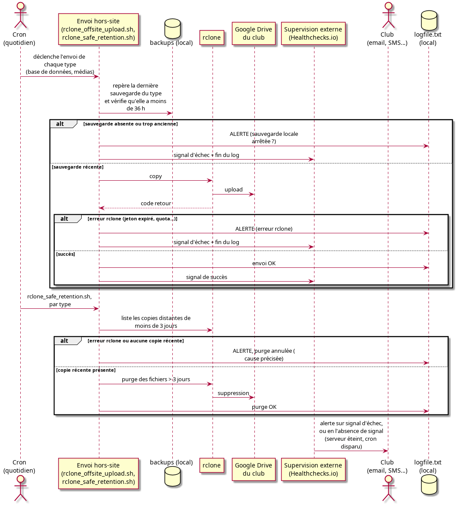

# Design : Sauvegarde Hors-Site des Backups

Complète `doc/prds/sauvegarde_hors_site_prd.md`, qui définit les exigences produit. Ce document ne les répète pas et se concentre sur le positionnement architectural du mécanisme et sur la question centrale : ce mécanisme doit-il être développé comme partie du projet GVV, ou peut-il être entièrement couvert par des outils externes ?

## 1. Positionnement architectural

Le mécanisme hors-site n'est **pas une fonctionnalité de l'application GVV** (CodeIgniter/PHP). Il se situe au même niveau que les scripts déjà existants `tools/autobackup.py` et `tools/autobackup_media.py` : un outil d'exploitation, déclenché par cron, qui agit sur le système de fichiers du serveur, en dehors de toute requête HTTP et de tout contrôleur.

Cette séparation découle directement du PRD (ENF-001, et l'exclusion explicite de `GoogleCal.php` en 3.2) : une panne du mécanisme hors-site ne doit jamais pouvoir affecter l'application, et réciproquement l'application ne doit pas être un point de passage obligé pour l'envoi hors-site. Conséquence directe :

* Aucun contrôleur, vue, modèle ou migration de base de données GVV n'est concerné.
* Le mécanisme n'a pas besoin d'accéder à la base de données GVV ni à sa session : il opère uniquement sur les fichiers déjà produits dans `backups/`.
* Il peut continuer à fonctionner même si l'application GVV est indisponible.

## 2. Composants et responsabilités

| Composant | Rôle | Nouveau ? |
| :--- | :--- | :--- |
| `tools/autobackup.py`, `tools/autobackup_media.py` | Produisent les sauvegardes locales (déjà existant, hors périmètre de ce PRD) | Non |
| `tools/rclone_offsite_upload.sh` | Envoi hors-site d'un type de sauvegarde : repère la dernière sauvegarde locale, vérifie qu'elle est récente, l'envoie par `rclone copy`, journalise le résultat et signale succès ou échec au service de supervision. Aucun secret ni chemin en dur (tout en paramètre) | Oui (cœur du besoin) |
| **rclone** | Client CLI qui gère l'upload vers Google Drive et la suppression des fichiers distants trop anciens (`--min-age`) ; sa configuration (client OAuth **dédié au club** — cf. §4 — et jeton du compte `info@planeur-abbeville.fr`) est stockée sur le serveur, hors du dépôt (ENF-002) | Outil externe existant |
| `tools/rclone_safe_retention.sh` | Encapsule la purge `rclone delete --min-age` d'un garde-fou : n'efface les fichiers distants anciens que s'il subsiste déjà une sauvegarde distante de moins de trois jours, sinon annule la purge et journalise une alerte qui distingue une erreur rclone d'une absence de copie récente. Aucun secret ni chemin en dur (tout en paramètre) | Oui |
| **Supervision externe** (Healthchecks.io, voir §5) | Reçoit un signal de succès ou d'échec par type de sauvegarde ; alerte (email, SMS…) sur échec signalé ou en l'absence de signal | Service externe, configuration seulement |
| `backups/logfile.txt` | Journal partagé, déjà utilisé par les deux scripts existants ; l'envoi hors-site peut y ajouter ses propres lignes selon la même convention | Existant, réutilisé |

## 3. Flux d'exécution quotidien

Points à noter :

* L'upload ne régénère jamais de sauvegarde (EF-004) : le script se contente de désigner le fichier le plus récent de chaque type dans `backups/`. Il refuse un fichier trop ancien (36 h par défaut) : sinon, une panne de la sauvegarde locale ferait re-copier sans erreur un fichier inchangé et passerait inaperçue.
* La rétention distante (EF-006/EF-007, 3 jours) s'appuie sur `rclone delete --min-age`, appliqué indépendamment aux deux types de sauvegarde, mais **encapsulé** dans `tools/rclone_safe_retention.sh`. Une purge aveugle par âge est dangereuse : si les sauvegardes locales cessent d'être produites, l'upload re-copie sans erreur un fichier inchangé pendant que la purge continue de tourner et finit par effacer la dernière copie distante valide. Le garde-fou vérifie qu'une sauvegarde distante récente subsiste avant de purger — seule logique à maintenir, une dizaine de lignes shell.
* L'échec d'un seul des deux envois (CL-002) est détecté indépendamment de l'autre : un check de supervision par type de sauvegarde, pour que l'alerte identifie précisément le type concerné (EF-009).
* Aucune notification n'est envoyée en cas de succès complet (EF-010) — le seul signal de bonne santé est l'absence d'email, complété par la trace dans `logfile.txt` et par la présence des fichiers sur le Google Drive pour qui veut vérifier activement.

## 4. Sécurité des identifiants

`rclone config` stocke le jeton OAuth du compte Google Drive dans un fichier de configuration propre à `rclone` (hors du dépôt Git, sur le serveur uniquement), ce qui couvre nativement ENF-002/CA-006. Ce fichier est propre au compte système qui exécute le cron (pas `root`, sauf crontab de `root`).

Google ayant annoncé (préavis de 90 jours, courant 2026) la facturation des appels API passant par le client OAuth partagé par défaut de `rclone`, la configuration utilise un **client OAuth propre au club**, créé dans Google Cloud Console sur le compte cible avec le seul scope `drive.file`. Cela n'introduit pas de secret sensible supplémentaire : le `client_secret` d'une application OAuth « installée » n'est pas un secret fort (il est volontairement visible dans de nombreux projets open source), il est simplement gardé hors du dépôt par principe.

La liste des destinataires d'alerte (QO-001) se règle dans le service de supervision (intégrations du compte Healthchecks.io), hors du serveur et hors du dépôt. Les URL de ping, passées en paramètre dans la crontab, ne permettent que de signaler un état ; aucune table de GVV n'est sollicitée, ce qui préserve le découplage vis-à-vis de la base de données applicative.

## 5. Alerte en cas d'échec

Une version antérieure de ce document classait l'alerte comme optionnelle, la présence des fichiers récents pouvant se vérifier à la main. L'exploitation l'a démenti : en septembre 2026, le jeton Google a expiré et l'envoi s'est arrêté ; malgré une ligne `ALERTE` chaque nuit dans `logfile.txt`, la panne n'a été découverte que deux mois plus tard. Une vérification qui dépend de quelqu'un qui pense à regarder ne protège pas. L'alerte (EF-008 à EF-010, CL-002, CL-005) est donc **obligatoire**, et doit venir de l'extérieur du serveur pour couvrir aussi un serveur éteint ou un cron disparu.

Deux familles d'outils externes évitent d'avoir à écrire la logique de notification :

### Outils associés à Google Drive

* **Google Apps Script lié au compte Drive cible** : un script (hébergé et exécuté par Google, pas sur le serveur GVV) déclenché par un déclencheur temporel quotidien, qui vérifie la date du fichier le plus récent dans le dossier de sauvegarde et envoie un email via `MailApp`/`GmailApp` si aucun fichier récent n'est trouvé. C'est l'approche la plus directement « associée à Google Drive » : elle tourne entièrement côté Google, sur le compte `info@planeur-abbeville.fr` déjà utilisé, sans toucher au serveur ni au dépôt GVV. Des exemples publics existent pour la variante « notifier à l'ajout d'un fichier » ([Net-RVA, GitHub](https://github.com/Net-RVA/Automate-Your-Google-Drive-Email-Alerts-for-New-Files-with-Apps-Script-)) ; la variante « alerter en l'absence d'ajout récent » est une adaptation directe (comparer la date du fichier le plus récent à `Date.now()`).
* **La notification native de Drive** (icône cloche, « suivre » un fichier/dossier) alerte sur toute modification mais ne peut pas détecter une *absence* d'activité — elle ne couvre donc pas le besoin telle quelle.
* **Applications tierces du Google Workspace Marketplace** (ex. « DriveWatcher ») proposent une notification périodique (quotidienne/hebdomadaire) sur l'activité d'un dossier, relayée vers Google Chat plutôt que par email ; à vérifier si elles couvrent le cas « aucune activité » avant de les retenir, leur usage documenté portant surtout sur la notification de nouveaux fichiers.

### Alternative généraliste : supervision par « dead man's switch »

Indépendamment de Google Drive, **Healthchecks.io** (et équivalents : Cronitor, cron-job.org) est un service de supervision de tâches planifiées : le job envoie un simple ping HTTP (`curl`) à la fin de son exécution ; si le ping n'arrive pas dans la fenêtre attendue, le service alerte automatiquement par email (et d'autres canaux). Offre gratuite jusqu'à 20 jobs surveillés, auto-hébergeable si besoin.

Appliqué ici, c'est la solution retenue : deux checks distincts (base de données, médias), chacun signalé par `tools/rclone_offsite_upload.sh` à la fin de l'envoi correspondant, en succès ou en échec (`/fail`, avec la fin du log en pièce jointe). Le script porte la détection (sauvegarde absente ou trop ancienne, erreur rclone) ; le service porte la notification (email, SMS selon l'offre, Telegram, Signal, ntfy, ou webhook vers une passerelle SMS) et l'alerte en l'absence de signal. Cette approche couvre EF-009 (distinguer le type en échec). Le Google Apps Script reste un complément possible, qui contrôle ce qui est réellement présent sur le Drive.

## 6. Analyse : implémentation GVV ou outils externes ?

### Ce qui est déjà couvert nativement par `rclone` seul

* L'upload vers Google Drive (`rclone copy`).
* L'authentification OAuth et son stockage sécurisé (`rclone config`), avec un client OAuth propre au club (§4).

Pour ces points, un simple appel `rclone` en ligne de commande suffit : aucune ligne de code à écrire ni à maintenir dans le dépôt GVV. C'est cohérent avec le périmètre du PRD, qui nomme `rclone` comme l'outil imposé plutôt que de demander une intégration API Google sur mesure.

### Ce qui demande de minces scripts d'exploitation

Deux scripts shell, au même niveau que `tools/autobackup.py` et sans lien avec l'application GVV :

* `tools/rclone_offsite_upload.sh` : désigner le fichier le plus récent (EF-001/EF-002), refuser un fichier trop ancien, envoyer, journaliser et signaler le résultat à la supervision. Une première version se contentait d'une ligne shell dans la crontab (`ls -t … | head -1 && rclone copy …`) ; elle ne détectait ni une sauvegarde locale arrêtée, ni ne prévenait personne d'un échec rclone.
* `tools/rclone_safe_retention.sh` : la rétention distante par âge (`rclone delete --min-age`) ne peut **pas** être laissée en cron brut (§3).

Ils partagent une fonction de journalisation dans `tools/rclone_common.sh`. Les deux scripts sont testés par PHPUnit avec de faux exécutables `rclone` et `curl`, pour couvrir les cas d'échec sans accès réseau.

### Conclusion

Le mécanisme hors-site ne nécessite **aucun développement applicatif GVV** (contrôleur, vue, modèle, migration). Il se réduit à quatre entrées cron appelant les deux scripts d'exploitation, plus une configuration chez un service de supervision externe (deux checks Healthchecks.io), qui porte la notification. Aucune logique d'envoi d'email n'est écrite dans le dépôt.

## 7. Points restant à trancher

* Le PRD (`doc/prds/sauvegarde_hors_site_prd.md`) liste EF-008 à EF-010 et CL-002/CL-005 comme des exigences fermes ; ce document les reclasse optionnelles (§5). Si cette reclassification est retenue, le PRD devrait être mis à jour en conséquence pour rester cohérent avec ce design.
* Si l'alerte est mise en place : choix entre Google Apps Script (plus intégré à Google Drive, zéro dépendance externe supplémentaire) et Healthchecks.io/équivalent (généraliste, réutilisable pour d'autres tâches planifiées du club) — à trancher selon la préférence de maintenance à long terme.
* Nom exact et structure du dossier distant sur le Google Drive du club (`info@planeur-abbeville.fr`, cf. PRD QO-002).
* **Fréquence et rétention** : passées de hebdomadaire/deux mois à **quotidien/trois jours** (décision produit). À noter : une rétention distante de trois jours ne conserve que 3 à 4 sauvegardes à la fois — si un problème (corruption, suppression accidentelle) n'est détecté qu'après ce délai, aucune copie distante saine n'est plus disponible. Ce risque existait déjà avec la rétention locale à granularité quotidienne (`doc/features/Backup.md`), mais mérite d'être gardé à l'esprit si la fenêtre de rétention distante devait encore être raccourcie.
