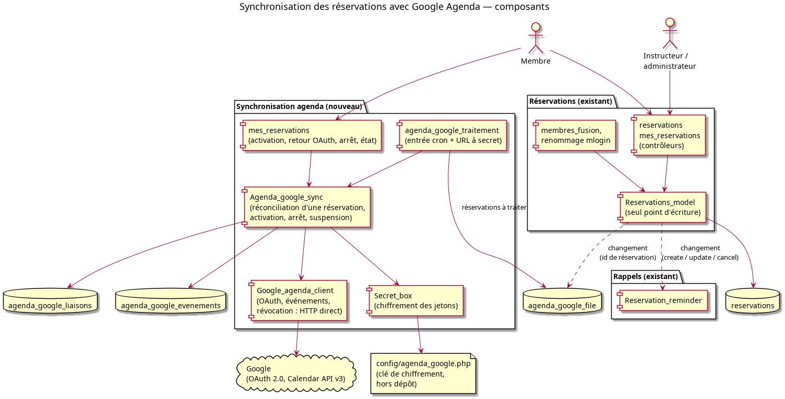
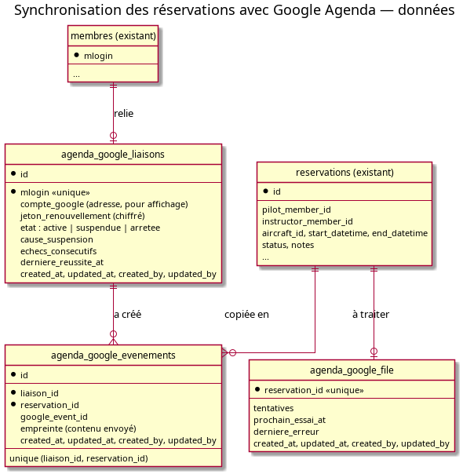

# Design : Synchronisation des réservations avec Google Agenda

Complète `doc/prds/synchronisation_agenda_google_reservations_prd.md`, qui définit les exigences (identifiants SYNC-…). Ce document ne les répète pas : il décrit l'architecture retenue et les décisions qui la justifient.

## 1. Constats sur l'existant

| Élément | Constat | Conséquence |
| :--- | :--- | :--- |
| Écriture des réservations | `Reservations_model` crée et supprime. Mais les modifications passent par des `UPDATE` directs dans le contrôleur `reservations` (formulaire et glisser-déposer du planning). La fusion et le renommage de membres modifient aussi la table. Seuls le formulaire et la suppression préviennent les rappels (`Reservation_reminder::handle_event`) ; un déplacement au glisser-déposer ne les prévient pas. | Un seul point d'écriture et de notification est nécessaire, sinon l'agenda ne serait pas mis à jour dans ces cas (SYNC-MAJ-05). |
| Bibliothèque Google | `third_party/google-api-php-client` est la version 0.6 (≈ 2012). `GoogleCal` l'utilise avec un jeton unique stocké dans `config/google.php`, pour l'agenda des présences. | Elle ne convient pas à une autorisation par membre et n'est plus maintenue. Le nouveau composant ne s'appuie pas dessus. |
| Ordonnanceur | `reservation_scheduler` (cron horaire et URL à secret) porte les rappels et les alarmes. | Une heure ne suffit pas à SYNC-MAJ-08 (« quelques minutes ») : il faut une entrée plus fréquente. |
| Chiffrement | `config.php` (non suivi) a une `encryption_key` par défaut, identique d'une installation à l'autre. L'extension `sodium` est disponible. | Les jetons sont chiffrés avec une clé propre à l'installation, générée à la première activation. |

## 2. Décisions

1. **Réconciliation plutôt que rejeu d'événements.** Un changement de réservation n'envoie pas « créer / modifier / supprimer » à Google. Il inscrit seulement l'identifiant de la réservation dans une file. Le traitement de la file calcule l'état attendu, c'est-à-dire les agendas où la réservation doit figurer et avec quel contenu. Il le compare aux événements déjà créés, puis crée, met à jour ou supprime ce qu'il faut. Conséquences :
   - le traitement est idempotent : le rejouer ne crée pas de doublon (SYNC-MAJ-07) ;
   - un échec se règle en retentant simplement, sans ordre d'événements à respecter (SYNC-ERR-02) ;
   - le changement de pilote ou d'instructeur (SYNC-MAJ-06) ne demande pas de cas particulier.
2. **Un seul point d'écriture des réservations.** Toutes les écritures passent par `Reservations_model` : contrôleur `reservations` (formulaire et glisser-déposer), `mes_reservations`, fusion et renommage de membres. Après chaque écriture, le modèle prévient les rappels comme aujourd'hui (même contrat `create / update / cancel`, déplacé des contrôleurs vers le modèle), et inscrit la réservation dans la file de synchronisation. Les rappels profitent de ce regroupement : le glisser-déposer les prévient enfin.
3. **File traitée en dehors de la requête.** La requête de réservation ne fait qu'une écriture locale dans la file : elle n'est ni ralentie ni bloquée par Google (SYNC-ERR-01). Une entrée `agenda_google_traitement` traite la file (le contrôleur ne peut pas s'appeler `agenda_google_sync` : sa classe entrerait en conflit avec la bibliothèque `Agenda_google_sync`). Comme `reservation_scheduler`, elle s'appelle en ligne de commande ou par URL protégée par un secret. Sa cron conseillée tourne toutes les minutes ; si la file est vide, elle se termine aussitôt.
4. **HTTP direct vers Google, sans la bibliothèque embarquée.** `Google_agenda_client` ne parle qu'aux points d'accès dont la fonction a besoin, avec l'extension `curl`, comme la bibliothèque HelloAsso (la bibliothèque `Requests` présente dans `third_party` date de 2014 et produit des avertissements en PHP 8.4) : autorisation et échange du code, renouvellement du jeton d'accès, création, modification et suppression d'un événement, révocation. Le périmètre d'autorisation demandé est le plus étroit possible : écriture des événements (`calendar.events`), plus `openid email`, non sensibles, pour connaître l'adresse du compte affichée au membre.
5. **Seul le jeton de renouvellement est conservé.** Il est chiffré par `Secret_box` (sodium, clé de `config/agenda_google.php`, fichier hors dépôt créé à la première activation). Le jeton d'accès n'est jamais enregistré : il est obtenu au début de chaque traitement. À l'arrêt, le jeton est révoqué chez Google puis effacé (SYNC-ARR-04).
6. **GVV ne touche qu'aux événements qu'il a créés.** Chaque événement créé est enregistré dans `agenda_google_evenements`, avec son identifiant Google et une empreinte du contenu envoyé. GVV ne modifie ou ne supprime que ces événements (SYNC-MAJ-09) et ne lit ni ne parcourt jamais le reste de l'agenda. L'empreinte évite de renvoyer à Google un événement qui n'a pas changé.
7. **Les liens sont conservés après l'arrêt.** L'arrêt passe la liaison à `arretee` et efface le jeton, mais conserve `agenda_google_evenements`. Une réactivation avec le même compte retrouve ainsi les événements des réservations à venir au lieu de les dupliquer (PRD, §8). Avec un autre compte, les anciens liens sont abandonnés.

## 3. Composants

| Composant | Responsabilité | Nouveau ? |
| :--- | :--- | :--- |
| `Reservations_model` | Seul point d'écriture des réservations ; après chaque écriture, prévient les rappels et inscrit la réservation dans la file. | Modifié |
| `Reservation_reminder` | Inchangé ; appelé par le modèle au lieu des contrôleurs. | Non |
| `mes_reservations` | Activation (redirection vers Google, retour avec le code d'autorisation), arrêt, affichage de l'état (SYNC-ERR-04). | Modifié |
| `Agenda_google_sync` | Règles métier : réconciliation d'une réservation, ajout des réservations à venir à l'activation, arrêt, suspension, compteur d'échecs, avertissement du membre. | Oui |
| `Google_agenda_client` | Adaptateur vers Google : aucune règle métier, il traduit les appels et classe les erreurs (passagère, autorisation invalide, événement disparu). | Oui |
| `Secret_box` | Chiffrement et déchiffrement des jetons ; création de la clé à la première utilisation. | Oui |
| `agenda_google_traitement` (contrôleur) | Entrées cron et URL à secret, qui traitent la file par lots. | Oui |
| `agenda_google_liaisons` (contrôleur) | Liste des liaisons suspendues pour l'administrateur du club (SYNC-ERR-05), accessible depuis l'onglet Modules. | Oui |
| Page Configuration | Activation de la fonction (onglet Modules) ; identifiant et secret de l'application Google (onglet Système, secret masqué). | Registre complété |
| `agenda_google_bouchon` | Sur une plateforme de test seulement : remplace Google pour les tests de bout en bout (écran d'autorisation simulé, événements enregistrés localement). `Google_agenda_client` est dirigé vers lui par le paramètre `agenda_google_bouchon` de `program.php`, absent de la page Configuration ; sans ce paramètre, le bouchon répond 404 à toute requête. | Oui |

## 4. Données

* **`agenda_google_liaisons`** : une ligne par membre qui a activé la synchronisation au moins une fois. Elle contient l'état, le compte Google affiché au membre, le jeton chiffré, la cause d'une suspension, le nombre d'échecs consécutifs et la date de la dernière réussite.
* **`agenda_google_evenements`** : un lien par couple (liaison, réservation). Il donne l'identifiant de l'événement Google et l'empreinte du dernier contenu envoyé.
* **`agenda_google_file`** : les réservations à réconcilier. Une réservation n'y figure qu'une fois, quel que soit le nombre de changements accumulés. La ligne porte le nombre de tentatives et la date du prochain essai.

Les trois tables ont les champs d'audit obligatoires. Elles sont créées par une migration (186).

## 5. Flux

**Activation.**
1. Le membre demande l'activation depuis « Mes réservations ».
2. Il est redirigé vers Google. Un paramètre d'état lié à sa session protège le retour contre une requête forgée.
3. Au retour, GVV échange le code d'autorisation contre un jeton de renouvellement, le chiffre et l'enregistre.
4. Les réservations à venir où le membre est pilote ou instructeur sont inscrites dans la file.
5. Le compte rendu de l'activation (SYNC-ACT-06) donne le nombre de réservations inscrites. Elles apparaissent dans l'agenda au passage suivant du traitement.

**Changement d'une réservation.**
1. `Reservations_model` écrit la réservation.
2. Il prévient les rappels.
3. Il inscrit la réservation dans la file. Un échec de cette inscription est journalisé, mais n'annule jamais l'écriture de la réservation.

**Traitement de la file.** Pour chaque réservation de la file :
1. **Calcul des agendas attendus** : ceux du pilote et de l'instructeur dont la liaison est active. Une réservation supprimée, ou un bloc d'indisponibilité sans pilote, n'en a aucun.
2. **Comparaison** avec les liens de cette réservation dans `agenda_google_evenements`. GVV crée l'événement qui manque, sauf pour une réservation déjà terminée, met à jour celui dont l'empreinte a changé, et supprime celui qui n'est plus attendu. Les liens appartenant à une liaison arrêtée sont laissés tels quels, ce qui laisse l'événement dans l'agenda (SYNC-ARR-02).
3. **Issue :**
   - en cas de succès, la réservation sort de la file ;
   - après une erreur passagère, elle y reste, et l'essai suivant est repoussé de plus en plus loin ;
   - après une autorisation invalide, la liaison est suspendue (SYNC-ERR-03), le membre reçoit un e-mail, et ses réservations ne sont plus traitées jusqu'à ce qu'il la rétablisse.

**Arrêt.**
1. Le jeton est révoqué chez Google, puis effacé.
2. La liaison passe à `arretee`.
3. Ni les événements ni les liens ne sont touchés.

## 6. Règles transverses

* **Événement supprimé à la main par le membre** : GVV ne le recrée pas tant que la réservation ne change pas. Quand elle change, la mise à jour reçoit « événement disparu » de Google, et l'événement est alors recréé (PRD, §8).
* **Fuseau horaire** : les dates sont envoyées avec le fuseau horaire du club (SYNC-CNT-04).
* **Contenu** : le contenu de l'événement est produit par un seul composant, `Agenda_google_sync`, à partir de la réservation. L'empreinte est calculée sur ce contenu, ce qui garantit qu'aucune donnée financière ne peut y entrer (SYNC-CNT-03).
* **Droits** : un membre ne gère que sa propre liaison (SYNC-ACT-07). Un administrateur du club ne voit, dans la liste des liaisons suspendues (SYNC-ERR-05), que le membre, l'état et la cause, jamais le jeton.
* **Traçabilité** : l'activation, l'arrêt, la suspension et l'échec persistant sont journalisés avec le membre concerné. Le jeton n'apparaît jamais dans les journaux.

## 7. Risques

| Risque | Parade |
| :--- | :--- |
| Validation de l'application par Google pour le périmètre `calendar.events`, qui est classé sensible | Démarche faite par le club ou l'hébergeur avant l'ouverture aux membres. Jusque-là, l'application en mode test est limitée aux comptes déclarés, ce qui suffit pour la recette. |
| Écriture de réservation oubliée en dehors de `Reservations_model` | Les écritures existantes sont migrées dans le modèle, et un test signale toute nouvelle écriture directe dans la table. |
| Quotas de l'API Google | Le traitement se fait par lots, et l'empreinte évite les appels inutiles. |
| Perte de la clé de chiffrement | Les liaisons deviennent inutilisables et passent en suspension « réautorisation nécessaire ». Les membres réactivent ; aucune donnée de réservation n'est perdue. |
