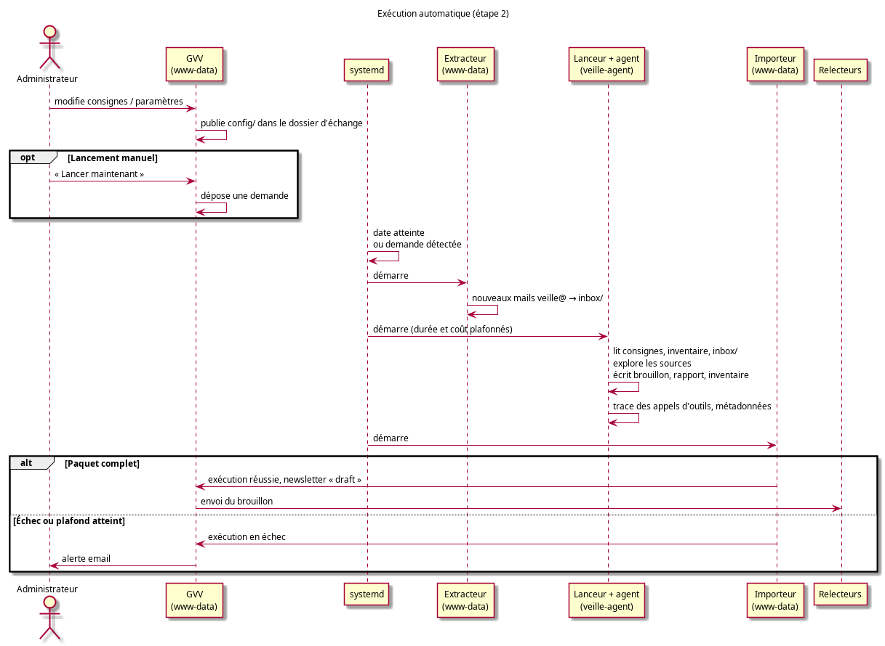

# Design Notes — Veille documentaire

Date : 24 octobre 2026

Document de référence : [PRD_Veille_Securite_Automatisee.md](../prds/PRD_Veille_Securite_Automatisee.md)

---

## Contexte et objectif

Le système de veille documentaire produit une newsletter périodique à partir d'un ensemble de sources (boîte mail, flux RSS, sites web). Un agent IA explore les sources, rédige un brouillon et un rapport d'activité. L'administrateur le soumet aux relecteurs par email, trie leurs réponses dans GVV et fait produire de nouvelles versions par l'agent IA jusqu'à la validation ; la newsletter est alors archivée et diffusée aux abonnés.

---

## Deux étapes de déploiement

| | Étape 1 | Étape 2 |
|---|---|---|
| Agent | Claude Desktop sous Windows (disque, navigation web) | Claude Code non interactif avec navigateur, sur le serveur d'exploitation |
| Déclenchement | L'administrateur, à la main | Timer du serveur, ou demande depuis GVV |
| Entrées de l'agent | Kit téléchargé depuis GVV : consignes en vigueur, inventaire courant, suggestions d'articles reportées | Mêmes fichiers, déposés par GVV dans le dossier d'échange, plus les mails extraits de la boîte de collecte |
| Remise des résultats | Import manuel dans GVV | Import automatique dans GVV |
| Suite du cycle | Identique : relecture, validation, finalisation, diffusion (à l'étape 2, la première transmission aux relecteurs est automatique) |

Les deux étapes produisent le même **paquet d'exécution**. GVV ne distingue que l'origine de l'exécution ; tout ce qui suit l'import est commun. Le passage de l'étape 1 à l'étape 2 ne change donc ni le cycle de relecture, ni l'archive, ni les consignes, ni l'inventaire.

---

## Architecture

### Composants principaux

| Composant | Rôle |
|---|---|
| `newsletter_admin` | Interface GVV : consignes, paramètres, suivi des exécutions, import, transmission aux relecteurs, tri des suggestions, demande de nouvelle version, validation, publication |
| `newsletter` / `newsletter_public` | Archive membres ; abonnement et désinscription |
| `newsletter_model`, `newsletter_subscribers_model` | Newsletters (états, versions, fichiers) ; abonnés |
| `newsletter_contexts_model` | Versions des consignes de l'agent |
| `newsletter_runs_model` | Exécutions de l'agent et leur paquet d'exécution |
| Importeur d'exécution | Code GVV commun aux deux étapes : valide un paquet d'exécution, l'archive, crée la newsletter à l'état `draft` et l'exécution associée |
| Dossier d'échange (`/srv/veille`) | Seul point de contact entre GVV et l'agent du serveur |
| Extracteur de mails | Script CLI GVV : copie en lecture seule les nouveaux messages de la boîte de collecte dans le dossier d'échange |
| Lanceur d'agent | Script du serveur : prépare le répertoire de l'exécution, lance l'agent avec ses plafonds, enregistre la trace |
| Agent IA | Explore les sources, met à jour l'inventaire, écrit le brouillon et le rapport d'activité |
| Récupérateur de réponses | Appelé à la demande de l'administrateur : lit sur la boîte de veille les réponses au brouillon transmis et les enregistre comme suggestions |
| Réviseur | Appelé à la demande de l'administrateur : transmet à l'API Anthropic le brouillon courant et les suggestions acceptées, enregistre la version retournée |
| Finaliseur | Après validation : supprime les notes internes, produit le PDF, archive, déclenche l'envoi aux abonnés |
| Surveillance | Script quotidien sans IA (étape 2) : exécution absente ou en échec, alertes |

### Séparation des responsabilités

Trois identités système se partagent le travail, chacune avec ses seuls droits :

| Identité | Fait | N'a pas accès à |
|---|---|---|
| `www-data` (GVV, extracteur, importeur, surveillance) | Écrit la configuration de l'agent dans le dossier d'échange, extrait les mails, importe les résultats, envoie tous les emails | — |
| `veille-agent` (lanceur, agent) | Lit la configuration et les mails, écrit dans son répertoire d'exécution | Application GVV, base de données, identifiants IMAP et SMTP, configuration GVV |
| Administrateur technique | Installe le serveur, gère la clé d'API de l'agent | — |

Le serveur web ne lance jamais l'agent : il dépose une demande que le système prend en charge. L'agent ne peut déclencher aucun envoi d'email ; tout envoi est initié par le code PHP de GVV. Le contenu des sources est traité comme une donnée, jamais comme une consigne.

---

## Paquet d'exécution

Le paquet est le contrat entre l'agent et GVV, identique pour les deux étapes :

| Élément | Contenu | Étape 1 | Étape 2 |
|---|---|---|---|
| Brouillon | Newsletter en Markdown, structure du PRD § 5, pour une période | obligatoire | obligatoire |
| Rapport d'activité | Extrait du journal pour cette exécution : tentatives d'accès et codes de résultat, documents détectés, décisions et motifs, bilan | joint, absence signalée | obligatoire |
| Inventaire | Inventaire des documents suivis, mis à jour | joint, absence signalée | obligatoire |
| Métadonnées | Période, identifiant d'exécution, version des consignes, modèle, durée, coût, statut | saisies à l'import | écrites par le lanceur |
| Trace | Flux des appels d'outils réellement effectués par l'agent | — | oui |

L'importeur archive le paquet hors de l'espace servi directement par le serveur web : les rapports et les brouillons ne sont accessibles qu'au travers des contrôleurs, avec contrôle des rôles.

---

## Pilotage depuis GVV

GVV est la référence pour tout ce qui oriente l'agent :

- **Consignes** : un document Markdown (registre des sources, flotte, critères Q1 à Q3, règles de rédaction), édité dans GVV. Chaque enregistrement crée une version ; une version précédente peut être restaurée. Le contenu initial est le fichier de contexte mis au point lors du spike.
- **Suggestions reportées** : les suggestions d'articles que l'administrateur a reportées à l'édition suivante ; elles font partie des entrées de l'agent.
- **Inventaire courant** : celui du dernier paquet importé. Il est fourni à l'exécution suivante, ce qui permet la détection des modifications quelle que soit l'étape qui a produit l'exécution précédente.
- **Paramètres** : date d'exécution, modèle, plafonds de durée et de coût, relecteurs, délai de réponse des relecteurs.

À l'étape 2, chaque enregistrement dans GVV republie dans le dossier d'échange les consignes en vigueur, l'inventaire courant, les suggestions reportées et les paramètres. Le bouton « Lancer maintenant » y dépose une demande d'exécution.

---

## Déroulement d'une exécution (étape 2)

Un timer quotidien vérifie si la date d'exécution est atteinte ; une surveillance du dossier d'échange prend en charge immédiatement une demande déposée par GVV. L'exécution enchaîne trois unités systemd, chacune sous son identité : extraction des mails (`www-data`), agent (`veille-agent`), import (`www-data`). L'import crée la newsletter, puis GVV transmet le brouillon aux relecteurs.

Une exécution qui échoue, dépasse un plafond ou ne produit pas de paquet complet est enregistrée en échec ; la surveillance alerte l'administrateur et l'administrateur technique. La surveillance alerte aussi lorsqu'aucune exécution n'a abouti après la date prévue.

---

## Inventaire et détection des changements

L'inventaire contient une ligne par document suivi (source, identifiant stable, titre, version, date, URL, empreinte du contenu, dates de détection et de vérification, statut, décision, motif). À chaque exécution, l'agent compare ce qu'il lit à l'inventaire reçu :

- identifiant absent : `nouveau` ;
- empreinte, version ou date différente : `modifie` ;
- identifiant présent, rien de changé : `inchange` ;
- identifiant disparu de la source : `disparu`.

L'empreinte permet de détecter une modification que la source ne signale pas par sa date. Un document sans date de publication établie n'est pas classé nouveauté de la période (PRD F1.5).

---

## Rapport d'activité et preuve de veille

Le rapport d'activité est écrit par l'agent selon les codes de résultat des consignes (`OK`, `OK-VIDE`, `PARTIEL`, `INDISPONIBLE`, `NON-ACCESSIBLE`, `OBSOLETE`, `ALERTE`). À l'étape 2, la trace des appels d'outils, enregistrée par le lanceur et non par l'agent, permet de recouper ce rapport avec les accès réellement effectués.

Chaque exécution reste reliée à la newsletter qui en est issue et à la version des consignes utilisée. L'ensemble est conservé 36 mois au moins (PRD O4).

---

## Cycle de vie d'une newsletter

Les états sont stockés dans `newsletters.status`. Chaque action est déclenchée par l'administrateur, sauf mention contraire :

| De → Vers | Action |
|---|---|
| → `draft` | Import d'un brouillon pour une période (manuel à l'étape 1, automatique à l'étape 2) |
| `draft` → `reviewing` | Transmission du brouillon aux relecteurs, avec une date limite de réponse (automatique après un import automatique) ; `review_iteration` (tour de relecture) incrémenté |
| `reviewing` → `reviewing` | Récupération des réponses ; tri des suggestions |
| `reviewing` → `draft` | Demande d'une nouvelle version : le réviseur retourne la version suivante du brouillon |
| `draft` → `approved` | Validation (directe s'il n'y a pas de remarques) |
| `approved` → `published` | Finalisation : notes internes supprimées, PDF, archive, envoi aux abonnés |

L'état `validating` du schéma initial est réservé à une approbation par email d'un validateur distinct (évolution envisagée par le PRD) ; il n'est pas utilisé par le cycle de la version 1.

### Réponses et suggestions

Chaque email de transmission porte dans son sujet une référence à l'édition et à la version. Le récupérateur ne retient que les réponses portant cette référence et provenant d'un relecteur autorisé ; il ignore une réponse déjà enregistrée (identifiant de message). Les réponses écartées sont listées à l'administrateur avec le motif.

Chaque réponse retenue devient une suggestion, de nature `remarque` ou `article`. L'administrateur lui attribue une décision : `acceptee`, `modifiee` (avec le texte qu'il a corrigé), `rejetee` ou, pour un article, `reportee`. Une suggestion reportée reste en attente hors édition ; elle est reproposée au tri de l'édition suivante et figure dans les entrées de l'agent qui génère le prochain brouillon.

### Nouvelles versions

Le réviseur ne reçoit que le brouillon courant et les suggestions acceptées ou modifiées du tour de relecture courant ; celles des tours précédents sont déjà dans une version antérieure. La révision ne porte que sur du texte : elle passe par l'API Anthropic appelée depuis GVV, sans navigation. Chaque version est conservée ; l'administrateur voit les différences avec la version précédente avant de décider d'un nouveau tour ou de la validation.

### Notes internes et validation

Le brouillon contient des notes destinées au CPS et aux relecteurs : une section interne délimitée par un titre conventionnel, et des mentions entre crochets à compléter. Avant la validation, GVV liste les mentions entre crochets qui subsistent. À la finalisation, la section interne est retirée de façon déterministe, sans appel à l'IA, pour que le texte diffusé soit exactement le texte validé, notes en moins.

---

## Schéma de base de données

### Tables

**`newsletters`** : une ligne par édition. `draft_path` pointe vers la version courante du brouillon ; les versions précédentes restent dans le stockage de l'édition. `pdf_path` pointe vers le PDF publié, déposé dans l'archive des membres. `review_iteration` compte les tours de relecture ; `review_sent_at` et `review_deadline` datent la dernière transmission et la réponse attendue.

**`newsletter_reviews`** : suggestions issues des réponses des relecteurs. Outre l'expéditeur, l'itération et le contenu, elle porte l'identifiant du message (anti-doublon), la nature (`remarque`, `article`), la décision de l'administrateur et le texte modifié. Une suggestion reportée n'est rattachée à aucune édition jusqu'à son utilisation. Les pièces jointes sont stockées par suggestion, et non par édition, pour la suivre lorsqu'elle est reportée.

**`newsletter_contexts`** : versions successives des consignes de l'agent ; une seule version est active.

**`newsletter_runs`** : une ligne par exécution de l'agent, avec son origine (`desktop`, `schedule`, `manual`), son statut, la version des consignes utilisée, la durée, le coût, l'emplacement du paquet archivé et la newsletter produite.

**`newsletter_subscribers`** : abonnés extérieurs au club. `unsubscribe_token` est généré à l'inscription et inclus dans chaque email envoyé pour permettre la désinscription en un clic. Le double opt-in est géré par `confirmation_token` et `confirmed`.

**`newsletter_sendings`** : journal des envois par abonné, pour éviter les doublons en cas de re-run et tracer la diffusion.

---

## Abonnements

Le mécanisme d'abonnement est indépendant du cycle de génération automatique. Il peut servir des newsletters créées manuellement en publiant directement un PDF via l'interface d'administration.

La page d'abonnement publique (sans authentification GVV) expose deux actions : `subscribe` (formulaire nom/prénom/email → envoi du lien de confirmation) et `unsubscribe` (via le token de l'email ou formulaire email).

---

## Alertes immédiates (optionnelles)

Si l'administrateur active cette option, l'agent IA peut identifier dans les sources une information urgente (consigne de navigabilité urgente, NOTAM local) et la signaler dans son paquet d'exécution. L'importeur lit ce signal et envoie immédiatement une notification aux destinataires désignés par email ou SMS, selon le canal configuré pour chacun.

Ces alertes sont indépendantes du cycle de newsletter et ne déclenchent pas de brouillon.

---

## Choix de l'agent IA

### Résultats du spike

Deux expériences ont été comparées aux exigences F1.1 à F1.7 du PRD :

| | Claude Desktop (21/10/2026) | Appel API sans outil depuis GVV |
|---|---|---|
| Sources explorées | Web et RSS, y compris sites JavaScript et Calaméo via le navigateur ; boîtes mail non disponibles à cette date | Aucune |
| Nouveaux documents | Identifiés | Aucun (contenu fictif) |
| Documents modifiés | Un cas, par recoupement ; pas d'empreintes | Aucun |
| Analyse selon les critères | Pertinente, jusqu'à l'applicabilité par type d'aéronef | Appliquée à des éléments inventés |
| Références réelles | Oui, vérifiées ; une publication ancienne présentée comme récente | Non |
| Rapport d'activité | Complet | Aucun |

L'exploration adaptative (suivre un lien, chercher un bulletin chez un constructeur, lire un PDF, utiliser un navigateur) est ce qui fait la qualité du résultat. Un collecteur à lecteurs figés par source ne la reproduit pas.

### Décision

L'agent de l'étape 2 est Claude Code en mode non interactif, avec les outils de lecture web et un navigateur piloté (serveur MCP Playwright), plutôt que l'API Anthropic directe. Contraintes de mise en œuvre :

- **Aucune demande interactive** : mode de permissions sans confirmation, combiné à une liste fermée d'outils autorisés (lecture et écriture de fichiers, lecture web, navigateur, calcul d'empreinte), pour que l'exécution ne puisse ni bloquer ni sortir de son périmètre.
- **Plafonds** : durée maximale et coût maximal par exécution, fixés dans GVV.
- **Contexte explicite** : l'agent démarre sans configuration utilisateur ni mémoire ; il lit les consignes et l'inventaire depuis le répertoire de l'exécution.
- **Clé d'API** : dans l'environnement du service de l'agent, lisible seulement par `veille-agent`, jamais dans un fichier accessible au serveur web.

L'API Anthropic directe reste utilisée depuis GVV pour le traitement purement textuel de la révision (intégration des suggestions acceptées).

---

## Environnements

Le mécanisme de l'étape 2 est mis au point sur la machine de développement, puis le serveur d'exploitation (machine virtuelle Oracle Cloud sous Ubuntu) est configuré de la même manière, par un même script d'installation versionné. Ce script crée l'identité `veille-agent` et le dossier d'échange, installe Claude Code et le navigateur pour tout le système (et non dans le compte d'un utilisateur), et installe les unités systemd. Les valeurs propres à chaque machine (URL GVV, clé d'API) sont dans un fichier non versionné.

---

## Intégration dans GVV

### Feature flag

La fonctionnalité est entièrement protégée par le flag `$config['veille']` défini dans `program.php` (et `program.example.php`).

Comportement quand `veille` est `false` ou absent :
- Les contrôleurs `newsletter_admin`, `newsletter`, `newsletter_public` retournent une erreur 404.
- Les entrées de menu correspondantes sont masquées.
- Les scripts CLI (`bin/newsletter_*.php`) vérifient le flag et s'arrêtent proprement s'il est désactivé.

Le flag est `false` par défaut dans `program.example.php`. Il est activé manuellement par l'administrateur système dans `program.php` pour les clubs qui utilisent la fonctionnalité. L'étape 2 est en outre optionnelle : un club peut rester à l'étape 1 sans installer l'agent sur son serveur.

### Configuration

Les paramètres opérationnels (compte IMAP, relecteurs, délai de réponse, périodicité, date d'exécution, modèle, plafonds) sont configurables par un `club-admin` depuis `newsletter_admin/configuration`, qui écrit `application/config/newsletter.php`. Le mot de passe IMAP y est stocké obfusqué et n'est jamais réaffiché en clair. Les consignes sont en base (`newsletter_contexts`), pas dans ce fichier.

### Autres points d'intégration

- L'accès à l'archive est réservé aux membres actifs connectés.
- L'administration (consignes, configuration, exécutions, import, relecture, validation, abonnés) est réservée aux `club-admin`.
- Les scripts CLI de l'étape 2 (extracteur, importeur, surveillance) sont placés dans `bin/` et lancés par des unités systemd. La récupération des réponses, la révision et la finalisation sont des actions de l'interface.

---

## Hors périmètre (V1)

- Synchronisation des abonnés avec les membres GVV.
- Sources avec authentification (espaces licenciés des fédérations).
- Isolation réseau stricte de l'agent IA (envisagée en V2 si nécessaire).
