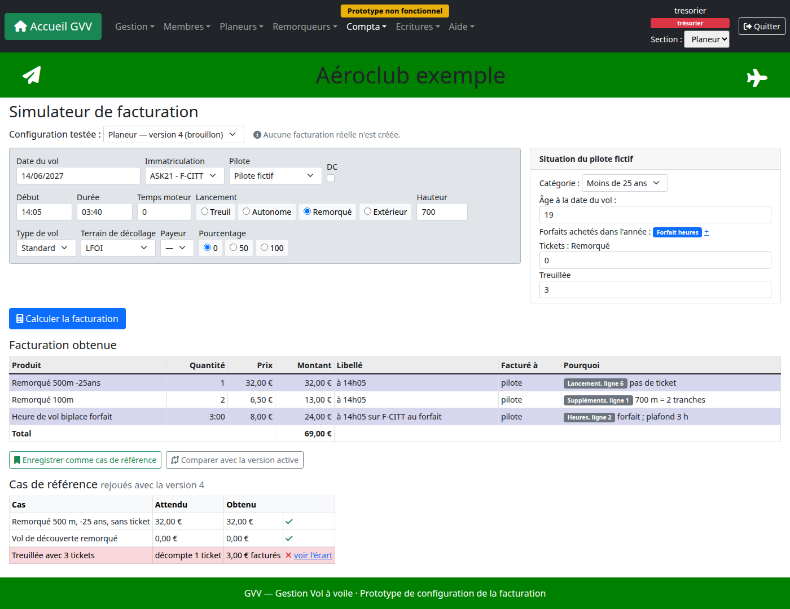
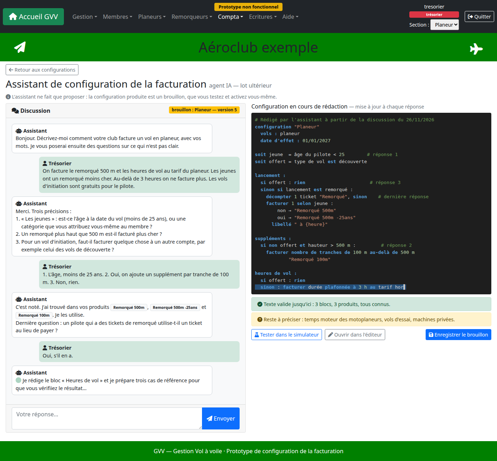
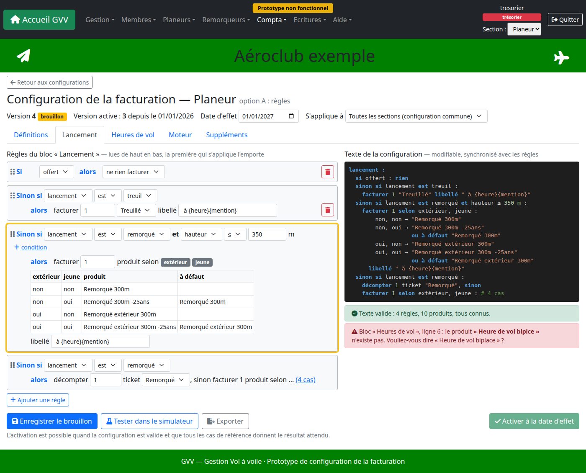
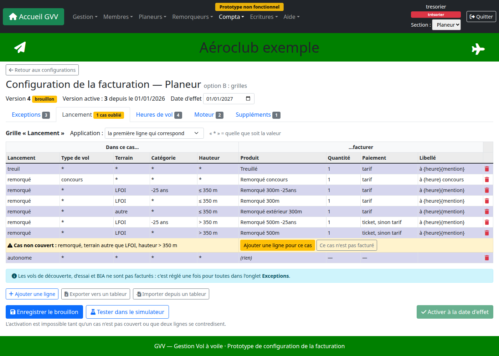

# PRD : Configuration de la facturation

*Statut : document de consultation — 2026-11-26.*

> **À l'attention des trésoriers relecteurs.** Ce document décrit ce que la configuration de la facturation doit permettre. Plusieurs choix restent ouverts et nous souhaitons votre avis avant de les trancher : ils sont regroupés au §9.2. Les exigences marquées « proposition » (CU7, EF26 et EF27) sont elles aussi soumises à votre avis.

Conception associée : [configuration_facturation_design.md](../design_notes/configuration_facturation_design.md)

## 1. Contexte

### 1.1 Produits et tarifs

GVV gère déjà des **produits** qui peuvent être facturés aux pilotes et des **tarifs** qui fixent le prix de ces produits dans le temps. Pour augmenter un produit à une date donnée, on fait évoluer son tarif.

**Configurer la facturation**, c'est définir quels produits sont facturés pour un vol, et en quelle quantité.

Quelques exemples :

* Un pilote utilise une machine louée à l'heure de vol et vole une heure trente : on lui facture 1,5 fois le tarif horaire.
* Un même vol peut entraîner la facturation de plusieurs produits, par exemple le tarif horaire et le moyen de lancement (treuillée ou remorqué).
* On peut ajouter un supplément pour les vols en double commande.
* On peut arrêter la facturation au-delà d'un seuil, par exemple ne facturer que les trois premières heures d'un vol en planeur.
* On peut appliquer des tarifs différents selon la catégorie du membre : moins de 25 ans, militaire, membre d'un comité d'entreprise…
* Les vols des titulaires d'un forfait peuvent être facturés autrement, ou pas du tout.

### 1.2 Critères de facturation

La facturation d'un vol peut dépendre de nombreux critères :

* sa durée ;
* le moyen de lancement ;
* la hauteur de largage ou la durée du remorqué ;
* le type de vol : vol de découverte, convoyage facturé à 50 %, vol en double commande… ;
* la catégorie du membre : moins de 25 ans, plus de 25 ans, militaire, membre d'un comité d'entreprise, retraité… ;
* l'âge du pilote à la date du vol ;
* le type de la machine ;
* le fait que le pilote soit ou non propriétaire de la machine ;
* l'achat d'un forfait ;
* la possession de tickets achetés d'avance (tickets de remorqué) ;
* le site de décollage (LFOI, LFQB…).

### 1.3 L'approche historique

Depuis 15 ans, la facturation de chaque club est gérée par un **module de facturation PHP propre au club**. C'est un ensemble de fonctions PHP qui déclenchent la facturation de produits au pilote. Pour configurer GVV, on choisit le module à utiliser ; le choix repose sur le nom du fichier.

Avantages :

* Cette approche est très souple : quelle que soit la complexité des règles de facturation, on peut assez facilement écrire une fonction qui les applique.
* Elle ne présente pas de risque de sécurité particulier : c'est un module PHP comme les autres dans le programme.

Inconvénients :

* **Il faut un informaticien.** Écrire ou modifier un module de facturation est un travail de programmation, même en s'inspirant des modules existants. Il demande de la rigueur, sur la logique comme sur la syntaxe du langage. Dans les faits, les clubs ont rarement ces compétences.
* **Le déploiement est technique.** Pour installer un module, nouveau ou modifié, il faut un accès SSH ou FTP au serveur et savoir exactement comment intervenir.
* **Le comportement propre à chaque club est codé en dur.** C'est probablement le dernier point qui sépare GVV d'une application professionnelle.

Les types de vol et les catégories de membre sont eux aussi définis dans un fichier de configuration du serveur. Aucun écran ne permet de les modifier, et plusieurs valeurs sont testées en dur dans le code.

### 1.4 Ce qu'utilisent les facturations existantes

L'inventaire ci-dessous a été établi en lisant les sept modules de facturation de GVV : le module générique (vols avion) et les modules propres aux clubs ACCABS, ACES, CPTA, DAC, ULM et Vichy. La nouvelle configuration doit pouvoir s'appuyer sur chacune de ces informations et produire chacun de ces effets, faute de quoi EF19 ne pourrait pas être tenue.

#### Informations sur le vol

| Information | Utilisation | Modules |
| :--- | :--- | :--- |
| Date du vol | Tarif en vigueur ; année de référence des forfaits et des cumuls | tous |
| Heure de début | Libellé (« à 14h05 ») | tous sauf générique |
| Durée du vol | Quantité d'heures facturées | tous |
| Temps moteur | Facturation du moteur (motoplaneurs) | ACCABS, CPTA, DAC, ULM, Vichy |
| Type de vol | Gratuité (découverte, essai, BIA, porte ouverte, remorquage, standardisation), demi-tarif (convoyage), produit dédié (concours), supplément double commande obligatoire (solo supervisé, vol DC), supplément supprimé (remise en vol), tarif propriétaire (vol propriétaire) | tous |
| Double commande | Supplément double commande ; choix du produit horaire | générique, ACES |
| Moyen de lancement | Treuillée, remorqué ou rien (autonome, extérieur) | tous les modules planeur |
| Hauteur de largage | Choix du produit (300 m, 500 m), demi-remorqué sous 250 m, suppléments par tranche de 100 m au-delà de 500 m, nom du produit construit à partir de la hauteur (« Sleepstart 1500ft ») | ACCABS, ACES, DAC, ULM |
| Durée du remorquage | Quantité facturée en centièmes | Vichy |
| Terrain de décollage | Produit de remorqué différent hors du terrain du club, supplément pour un autre terrain, barème de durée différent selon le terrain ; libellé | ACCABS, ACES |
| Nombre de passagers | Prix d'un vol de découverte avion (1, 2 ou 3 personnes) | ACES |
| Numéro de vol de découverte | Libellé | ACES |
| Ticket collé sur la planche | Le remorqué n'est pas facturé, ou seul le supplément l'est | ACES |
| Payeur et pourcentage (0, 50 ou 100 %) | Partage des frais | tous |
| Treuillard | Reçoit un crédit de ticket de treuillée | CPTA, Vichy |

#### Informations sur la machine

| Information | Utilisation | Modules |
| :--- | :--- | :--- |
| Immatriculation | Choix du produit horaire machine par machine ; libellé | ACES, Vichy ; tous pour le libellé |
| Tarif horaire, tarif forfait, tarif moteur de la machine | Produits facturés | tous |
| Tarif double commande, tarif propriétaire de la machine | Supplément DC, vol propriétaire | générique, ACES |
| Plafond de facturation de la machine | Durée maximale facturée | ACCABS, CPTA, DAC, ULM, Vichy |
| Machine privée | Heures non facturées (ACCABS, CPTA, DAC, ACES planeur) ; ou simple mention dans le libellé, sans application du plafond (ULM, Vichy, ACES avion) | tous sauf générique |
| Machine banalisée et son propriétaire | Le propriétaire ne paie pas sur son planeur banalisé ; un privé banalisé est facturé aux autres | CPTA |

#### Informations sur le pilote

| Information | Utilisation | Modules |
| :--- | :--- | :--- |
| Âge à la date du vol (moins de 25 ans) | Produit -25 ans, s'il a un tarif à la date du vol ; produit horaire -25 ans | ACCABS, ULM, Vichy |
| Case « moins de 25 ans » de la fiche | Produit -25 ans | ACES |
| Compte de facturation | Un pilote est facturé sur le compte d'un autre membre (enfant sur le compte d'un parent), avec son nom dans le libellé | générique, ACES |
| Forfait acheté dans l'année | Tarif forfait au lieu du tarif horaire | ACCABS, CPTA, ULM |
| Heures déjà facturées au forfait dans l'année | Un forfait de 15 ou 30 heures est consommé, le reste est facturé au tarif horaire | CPTA |
| Solde de tickets par type | Remorqué ou treuillée décomptés au lieu d'être facturés ; forfait en minutes ; forfait de 10 vols ; forfait illimité | ACCABS, ACES, CPTA, DAC, ULM, Vichy |
| Heures de vol cumulées dans l'année sur la machine | Tarif dégressif par tranches (jusqu'à 15 h, 26 h, 40 h, gratuit au-delà) | Vichy |

#### Informations sur les tarifs

| Information | Utilisation | Modules |
| :--- | :--- | :--- |
| Existence d'un tarif à la date du vol | Le produit -25 ans n'est utilisé que s'il a un tarif ; sinon, produit normal | ACCABS, ULM |

#### Calculs de quantité rencontrés

* une unité (treuillée, remorqué) ou une demi-unité (demi-remorqué) ;
* la durée du vol ou le temps moteur ;
* la moitié de la durée (convoyage, partage à 50 %) ;
* la durée plafonnée ;
* la durée au-delà d'une franchise (les 30 premières minutes d'un vol de découverte sont offertes) ;
* un barème dégressif de durée (plein tarif jusqu'à 1 h 30, moitié entre 1 h 30 et 2 h, forfait de 1 h 45 au-delà ; seuils différents selon le terrain) ;
* le nombre de tranches de 100 m au-dessus de 500 m ;
* la répartition d'un vol entre la part couverte par un forfait et le reste.

#### Effets produits

* une ligne de facturation au pilote, au payeur, ou partagée à 50 % ;
* une ligne au compte d'un tiers, par exemple le vol de découverte facturé au compte « vols de découverte » ;
* aucune ligne (vol gratuit), ou une ligne à quantité nulle qui garde une trace sur la facture ;
* le décompte d'un ticket, ou d'une quantité de minutes d'un forfait ;
* le crédit d'un ticket à un autre membre (le treuillard reçoit 1/10 de treuillée, ou une treuillée) ;
* l'échange de 7 tickets contre une treuillée gratuite ;
* un libellé composé d'éléments variables : heure, durée, machine, terrain, numéro de vol de découverte, mentions (« VI », « au forfait », « hors forfait », « Forfait 3/10 », « décompté »…), dans la langue du club.

#### Anomalies relevées

La lecture a fait apparaître des comportements qui ressemblent à des erreurs. EF19 impose de les reproduire, sauf décision contraire (§9.2, choix 4) :

* les modules ULM et Vichy vérifient le forfait sur l'année **en cours** et non sur l'année du vol : refacturer un vol de l'année précédente peut donner un autre résultat ;
* le module Vichy calcule la durée du remorquage à partir d'une donnée qu'il ne reçoit pas : la quantité facturée est toujours nulle ;
* le partage des frais ne traite que 0, 50 et 100 % ; un autre pourcentage n'est pas partagé.

## 2. Objectifs

* Un trésorier sans compétence en programmation peut définir et faire évoluer la facturation de son club depuis l'interface de GVV.
* Il peut vérifier le résultat de sa configuration avant de l'appliquer à de vrais vols.
* Aucun code exécutable n'est introduit dans GVV par la configuration.
* Les clubs qui utilisent déjà GVV passent au nouveau système sans aucun changement sur les montants ni sur les libellés facturés.
* GVV ne contient plus de comportement de facturation propre à un club.

## 3. Périmètre

### 3.1 Inclus

* La définition, depuis l'interface, des produits facturés et de leurs quantités pour chaque vol planeur et chaque vol avion, selon les critères du §1.2.
* Une configuration commune au club, et la possibilité d'une configuration propre à une section.
* Un simulateur de facturation.
* La gestion des catégories de membre et des types de vol.
* Le chargement et le remplacement d'une configuration complète.
* La reprise des configurations historiques de tous les clubs déployés et la preuve qu'elles donnent les mêmes résultats.

### 3.2 Hors périmètre

* La définition des produits et des tarifs, qui gardent leurs écrans actuels.
* La facturation périodique (voir [facturation_periodique_prd.md](facturation_periodique_prd.md)).
* La facturation du carburant (prises aux pompes), qui reste assurée par le mécanisme actuel.
* Les écritures comptables générées par un achat, qui ne changent pas.

## 4. Parties prenantes

* **Trésorier** : définit, teste et fait évoluer la configuration de son club.
* **Administrateur** : charge ou remplace une configuration complète, en particulier lors de l'installation d'un club.
* **Pilotes** : reçoivent les lignes de facturation ; ils ne doivent constater aucun changement lors de la bascule.
* **Mainteneurs de GVV** : reprennent les configurations historiques et garantissent la non-régression.

## 5. Cas d'utilisation

### CU1 : Définir la configuration de la facturation

En tant que trésorier, je veux définir la configuration de la facturation pour l'adapter aux besoins de mon club.

### CU2 : Tester avec un simulateur

En tant que trésorier, je veux tester la configuration avec un simulateur.

* Le simulateur se présente comme un écran de saisie de vol, planeur ou avion.
* Il accepte des paramètres supplémentaires qui ne figurent pas sur un vol, comme les forfaits achetés par le pilote ou les tickets qu'il possède.
* Il affiche les lignes de facturation que recevrait le pilote qui aurait effectué ce vol : produit, quantité, prix, montant, libellé, et payeur en cas de partage.
* Il ne crée aucune facturation réelle.



*Prototype non fonctionnel ([source HTML](../prototypes/configuration_facturation/prototype_simulateur.html)). La colonne « Pourquoi » indique la règle ou la ligne de grille qui a produit chaque ligne de facturation. Les cas de référence en bas de page illustrent la proposition CU7.*

### CU3 : Gérer les catégories de membre

En tant que trésorier, je veux créer, modifier ou supprimer les catégories de membre sur lesquelles la configuration s'appuie.

* Je ne peux pas supprimer une catégorie déjà utilisée. Si j'essaie, la suppression est refusée et on m'indique où elle est utilisée.

### CU4 : Gérer les types de vol

En tant que trésorier, je veux créer, modifier ou supprimer les types de vol sur lesquels la configuration s'appuie.

* Je ne peux pas supprimer un type de vol déjà utilisé. Si j'essaie, la suppression est refusée et on m'indique où il est utilisé.

### CU5 : Charger ou remplacer une configuration

En tant qu'administrateur, je veux charger ou remplacer une configuration de facturation pour l'adapter à un club.

### CU6 : Définir la configuration en dialoguant avec un agent IA

*Ce cas d'utilisation viendra dans un lot ultérieur (§10).*

En tant que trésorier, je veux définir la configuration de la facturation à partir d'une discussion avec un agent IA.

* J'expose en langage naturel la façon dont mon club veut facturer les vols.
* L'agent me guide dans la démarche et me pose les questions nécessaires pour lever les ambiguïtés et compléter ce que je n'ai pas précisé.
* Je réponds à ses questions en langage naturel, sans avoir à connaître la forme que prend une configuration.
* À l'issue de la discussion, l'agent me propose une configuration que je peux relire et tester avec le simulateur avant de décider de l'activer.



*Prototype non fonctionnel ([source HTML](../prototypes/configuration_facturation/prototype_agent_ia.html)). À gauche, la discussion : le trésorier décrit sa facturation avec ses mots et l'agent lève les ambiguïtés par des questions. À droite, la configuration se rédige au fil des réponses ; chaque passage indique la réponse dont il découle, et ce qui reste à préciser est signalé.*

### CU7 : Conserver des cas de référence (proposition)

*Proposition soumise à l'avis des trésoriers (§9.2, choix 3).*

En tant que trésorier, je veux enregistrer des vols types avec la facturation que j'attends, pour être sûr qu'une modification de la configuration ne change pas ce qui était juste.

* Depuis le simulateur, j'enregistre un vol et les lignes de facturation qu'il doit produire.
* Avant d'activer une nouvelle version de la configuration, GVV rejoue tous mes cas de référence et me montre chaque écart.
* Pour les clubs qui utilisent déjà GVV, des cas de référence sont produits à partir des vols déjà facturés.

## 6. Exigences fonctionnelles

### 6.1 Configuration

* **EF1** : La configuration indique, pour chaque vol, les produits à facturer et leur quantité, en fonction des critères du §1.2.
* **EF2** : Un vol peut entraîner la facturation de plusieurs produits.
* **EF3** : La quantité facturée peut être fixe (une treuillée), proportionnelle (temps de vol), plafonnée (les trois premières heures), ou réduite d'un pourcentage (convoyage à 50 %).
* **EF4** : La configuration détermine le libellé de chaque ligne de facturation.
* **EF5** : La configuration tient compte des forfaits et des tickets du pilote : un vol couvert par un forfait n'est pas facturé, ou l'est autrement, et un ticket disponible est décompté au lieu de facturer le produit.
* **EF6** : Le partage des frais avec un autre payeur, selon un pourcentage, continue de fonctionner quelle que soit la configuration.
* **EF7** : La configuration est utilisable par un trésorier sans connaissance en programmation. Lorsqu'elle s'appuie sur un langage de description, celui-ci doit être aussi naturel et facile à apprendre que possible.
* **EF8** : Une configuration incohérente ou incomplète est refusée à l'enregistrement, avec un message qui dit ce qui ne va pas et où.
* **EF9** : Le trésorier sait à tout moment quelle configuration est active et depuis quand.
* **EF10** : Une modification de la configuration est datée et attribuée à son auteur. Une configuration antérieure peut être consultée et restaurée.
* **EF10a** : Une configuration s'applique à partir d'une date d'effet. Un vol est facturé, et refacturé, avec la configuration en vigueur à la date du vol.
* **EF10b** : Le club dispose d'une configuration commune. Une section peut avoir sa propre configuration, qui s'applique alors aux vols de cette section à la place de la configuration commune. Le trésorier voit clairement quelle configuration s'applique à chaque section.

### 6.2 Simulateur

* **EF11** : Le simulateur reproduit exactement ce que donnerait la facturation réelle du même vol avec la même configuration.
* **EF12** : Le simulateur peut tester une configuration en cours d'élaboration, avant qu'elle soit activée.

### 6.3 Catégories de membre et types de vol

* **EF13** : Les catégories de membre et les types de vol sont gérés depuis l'interface (création, modification, suppression).
* **EF14** : La suppression d'une catégorie de membre ou d'un type de vol déjà utilisé est interdite. Est utilisé(e) une catégorie affectée à un membre, un type porté par un vol, ou l'un comme l'autre cité dans une configuration, quel que soit son statut, ou dans une facturation passée. La suppression refusée l'est avec un message qui dit où l'élément est utilisé. Les vols et facturations passés restent ainsi toujours lisibles.
* **EF15** : Les types de vol et les catégories de membre ne sont plus testés en dur dans le code de facturation.

### 6.4 Chargement d'une configuration

* **EF16** : Une configuration complète peut être exportée sous forme de fichier, puis chargée dans un autre déploiement ou dans le même.
* **EF17** : Avant de remplacer la configuration active, l'administrateur voit ce qui va changer et confirme. Une configuration chargée qui fait référence à des produits, catégories ou types de vol inconnus du club est signalée et n'est pas activée tant que les références ne sont pas résolues.

### 6.5 Reprise des configurations historiques

* **EF18** : Une fois le mécanisme en place, une nouvelle configuration est **générée automatiquement** pour chaque configuration historique existante, c'est-à-dire pour chaque module de facturation de club. Le trésorier du club n'a pas à la saisir.
* **EF18a** : Chaque configuration générée est vérifiée contre l'historique de facturation du club (EF19). Les écarts éventuels sont listés et corrigés avant toute activation.
* **EF19** : L'activation du nouveau système ne change ni les montants ni les libellés des lignes facturées, y compris quand on refacture des vols existants avec le nouveau système.
* **EF20** : Lors de la reprise des catégories de membre, chaque membre existant reçoit une catégorie qui permet de refacturer ses vols avec le nouveau système sans impact sur ses factures.
* **EF20a** : La catégorie de facturation d'un membre ne change que par une action du trésorier. Pour un critère qui doit évoluer seul avec le temps, la configuration s'appuie sur l'âge du pilote à la date du vol. Chaque club choisit le critère qui correspond à sa pratique.
* **EF21** : Tant qu'un club n'a pas basculé, son module historique continue de fonctionner sans changement.
* **EF22** : Le passage au nouveau système se fait à une date de bascule. Les vols antérieurs à cette date restent facturés, et refacturés, par le module historique ; les vols à partir de cette date le sont par la configuration. La date de bascule peut être alignée sur une date de gel des comptes, sans que ce soit obligatoire.

### 6.6 Configuration par un agent IA (lot ultérieur)

* **EF23** : Le trésorier peut définir une configuration en dialoguant en langage naturel avec un agent IA, qui le guide et l'interroge pour lever les ambiguïtés.
* **EF24** : La configuration proposée par l'agent est soumise aux mêmes contrôles qu'une configuration saisie à la main (EF8) et peut être testée avec le simulateur.
* **EF25** : L'agent ne fait que proposer : seul le trésorier active une configuration.

### 6.7 Cas de référence (proposition)

* **EF26** : Le trésorier peut enregistrer, depuis le simulateur, un vol type et les lignes de facturation attendues.
* **EF27** : Une nouvelle version de la configuration n'est activée qu'après le rejeu de tous les cas de référence. Les écarts sont présentés au trésorier, qui les corrige ou confirme le nouveau résultat.

## 7. Exigences non fonctionnelles

* **ENF1 – Sécurité** : la configuration ne permet d'exécuter aucun code, d'accéder à aucune donnée ni de modifier quoi que ce soit en dehors de la production de lignes de facturation et des mouvements de tickets (décompte, crédit). Un compte trésorier ou administrateur compromis ne doit pas permettre de compromettre le serveur ou la base de données.
* **ENF2 – Droits** : seul le trésorier modifie la configuration, les catégories et les types de vol. Seul l'administrateur charge ou remplace une configuration complète.
* **ENF3 – Performance** : la facturation d'un vol ne doit pas être sensiblement plus lente qu'aujourd'hui, y compris lors de la refacturation d'une saison complète.
* **ENF4 – Langues** : les écrans sont disponibles en français, anglais et néerlandais.
* **ENF5 – Lisibilité** : à chaque action (enregistrement, refus, activation, chargement), le résultat est évident pour l'utilisateur.

## 8. Critères d'acceptation

* La procédure de test démontre, pour chaque club déployé, que la nouvelle configuration donne les mêmes résultats que la facturation historique, pour tous les types de vol et tous les cas de facturation rencontrés dans les déploiements historiques : mêmes produits, mêmes quantités, mêmes montants, mêmes libellés, mêmes payeurs.
* Un trésorier qui n'a jamais programmé configure, à l'aide de l'interface et du simulateur, un cas de facturation qu'il n'avait pas encore (par exemple un supplément double commande), sans aide extérieure.
* Une tentative d'introduire du code dans une configuration est refusée.

## 9. Décisions et choix ouverts

### 9.1 Décisions

* **Carburant** : hors périmètre (§3.2).
* **Sections** : configuration commune au club, avec possibilité d'une configuration propre à une section (EF10b). Un club a déjà dû faire converger la facturation de l'ULM et de l'avion faute de cette possibilité.
* **Date d'effet** : chaque configuration a une date d'effet (EF10a) et la bascule se fait à une date (EF22). Comme les exigences de non-régression imposent des résultats identiques, ce choix n'a pas d'effet sur les montants. Il rend en revanche la bascule maîtrisable, et cohérente avec les dates de gel : un club en exploitation ne refacture pas un vol antérieur à sa date de gel.
* **Agent IA** : pas dans la première version. Il viendra dans un lot tardif et s'appuiera sur les mécanismes déjà en place (§10).

* **Tarif moins de 25 ans** (décision du 2026-11-26, susceptible d'être revue) : les modules historiques appliquent deux pratiques.
  * Un club se fonde sur une case à cocher de la fiche pilote. C'est un choix délibéré : un membre titulaire d'une licence fédérale « moins de 25 ans » continue d'être facturé à ce tarif jusqu'à ce que le trésorier change sa situation.
  * Les autres clubs calculent l'âge à partir de la date de naissance : le pilote garde le tarif jusqu'au 31 décembre de l'année de ses 25 ans, sans intervention du trésorier.

  Les deux pratiques sont conservées (EF20a). La catégorie de facturation, affectée par le trésorier, remplace la case à cocher. L'âge à la date du vol reste un critère de facturation pour les clubs qui l'utilisent. À la reprise, les membres dont la case est cochée reçoivent la catégorie « moins de 25 ans ».

### 9.2 Choix soumis à l'avis des trésoriers

Ces choix seront tranchés au lot 3. Les options et leurs conséquences techniques sont détaillées dans la [conception](../design_notes/configuration_facturation_design.md), au §2.

1. **Sous quelle forme préférez-vous décrire votre facturation ?**
   * *Option A – des règles* : « si le pilote a moins de 25 ans et que le vol est treuillé, alors facturer une treuillée -25 ans ». Les règles s'enchaînent, et on peut les écrire sous forme de texte ou les construire avec des menus. C'est très souple, mais l'effet combiné de plusieurs règles peut être difficile à prévoir.
   * *Option B – des grilles* : une grille par élément facturé (lancement, heures de vol, temps moteur, suppléments, exceptions), dont chaque ligne dit « dans tel cas, tel produit, en telle quantité ». C'est la forme de vos grilles tarifaires. GVV peut signaler les cas oubliés ou couverts deux fois, et la grille peut être préparée dans un tableur. En contrepartie, un besoin qui ne rentre dans aucun élément prévu demande une évolution de GVV.
   * Votre facturation se décompose-t-elle bien en lancement, heures de vol, temps moteur, suppléments et exceptions ? Sinon, qu'est-ce qui n'y rentre pas ?

   **Option A – règles**, construites avec des menus à gauche ; le même contenu sous forme de texte à droite (voir l'annexe A) :

   

   *Prototype non fonctionnel ([source HTML](../prototypes/configuration_facturation/prototype_regles.html)).*

   **Option B – grilles**, une par élément facturé ; GVV signale le cas que la grille a oublié :

   

   *Prototype non fonctionnel ([source HTML](../prototypes/configuration_facturation/prototype_tables.html)).*
2. **Comment exprimez-vous les réductions par catégorie de membre ?**
   * *Par des produits distincts*, comme aujourd'hui : « Remorqué 500 m » et « Remorqué 500 m -25 ans ».
   * *Par un prix qui dépend de la catégorie* : un seul produit « Remorqué 500 m », dont le prix diffère pour les moins de 25 ans. La configuration est plus courte, mais la gestion des tarifs change.
3. **Les cas de référence (CU7) vous seraient-ils utiles ?** Accepteriez-vous d'en tenir quelques dizaines pour votre club ?
4. **Faut-il reproduire les anomalies relevées au §1.4 ?** EF19 impose aujourd'hui des résultats identiques, anomalies comprises. Pour les clubs concernés (ULM, Vichy), préférez-vous que la nouvelle configuration corrige ces comportements à partir de la date de bascule ?

## 10. Livraison par lots

| Lot | Contenu | Exigences |
| :--- | :--- | :--- |
| 1 | Remplacement de la case à cocher « moins de 25 ans » par une catégorie de facturation du membre, et gestion des catégories de membre depuis l'interface. Le calcul par date de naissance reste inchangé | CU3, EF13, EF14, EF20, EF20a |
| 2 | Gestion des types de vol depuis l'interface, en remplacement de leur définition dans le fichier de configuration du serveur | CU4, EF13, EF14, EF15 |
| 3 | Analyse des configurations de facturation existantes, recueil de l'avis des trésoriers et choix du mécanisme de configuration | §9.2 |
| 4 | Définition et maintenance de la nouvelle configuration, simulateur, chargement et remplacement, cas de référence si ce choix est retenu | CU1, CU2, CU5, CU7, EF1–EF12, EF16, EF17, EF26, EF27 |
| 5 | Génération automatique des configurations des clubs à partir de leur configuration historique, remplacement de la facturation historique et bascule | EF18, EF18a, EF19, EF21, EF22 |
| 6 | Définition de la configuration par dialogue avec un agent IA | CU6, EF23–EF25 |

Les lots 1 et 2 apportent un bénéfice par eux-mêmes, même si la suite est différée.

## 11. Suites

* Après la mise en œuvre, corriger [drawbacks.md](../drawbacks.md), qui présente encore la configuration de la facturation par module PHP comme un défaut de GVV.

## Annexe A. Langage de description envisagé (option A)

*Ébauche soumise à l'avis des trésoriers. La syntaxe définitive sera fixée au lot 4 si l'option A est retenue.*

### A.1 Principes

* **Du français, pas du code.** Les mots-clés sont des mots courants, les produits et les types de vol sont désignés par leur nom tel qu'il apparaît dans GVV.
* **La même structure que la facturation.** Une configuration est découpée en blocs qui correspondent aux éléments facturés : lancement, heures de vol, moteur, suppléments. Un trésorier qui lit un bloc n'a pas à connaître les autres.
* **Pas de programmation.** Il n'y a ni boucle, ni variable modifiable, ni accès aux données en dehors du vocabulaire ci-dessous. On peut nommer une condition ou une valeur avec `soit`, mais pas la modifier.
* **Ce qui est commun à tous les clubs n'est pas écrit.** Le tarif en vigueur à la date du vol, le partage avec le payeur, la facturation sur le compte d'un parent et les mentions « payé pour » ou « partagé 50 % » sont appliqués par GVV, quelle que soit la configuration.

### A.2 Structure

```
configuration "<nom>"
  vols : planeur | avion
  date d'effet : JJ/MM/AAAA
  section : "<nom>"                    (facultatif : configuration propre à une section)

soit <nom> = <condition ou valeur>      (définitions réutilisables)

<bloc> :                                lancement | heures de vol | moteur | suppléments
  si <condition> : <action>
  sinon si <condition> : <action>
  sinon : <action>

# commentaire libre
```

Dans un bloc, les conditions sont lues de haut en bas et seule la première vraie s'applique, comme dans un « si… sinon si… » de la vie courante. Les blocs s'appliquent tous, l'un après l'autre.

### A.3 Mots-clés

**Conditions**

| Mot-clé | Exemple |
| :--- | :--- |
| `si`, `sinon si`, `sinon` | `si lancement est treuil :` |
| `et`, `ou`, `non`, parenthèses | `si jeune et non extérieur :` |
| `est`, `n'est pas` | `type de vol n'est pas concours` |
| `est parmi (…)` | `type de vol est parmi (découverte, essai, BIA)` |
| `<`, `≤`, `>`, `≥`, `=` avec unités | `hauteur ≤ 350 m`, `durée > 1 h 30` |
| `a acheté "<produit>" dans l'année du vol` | `pilote a acheté "Forfait heures" dans l'année du vol` |
| `a au moins N ticket(s) "<type>"` | `pilote a au moins 1 ticket "Remorqué"` |

**Vocabulaire du vol** : `durée`, `temps moteur`, `heure de début`, `lancement` (`treuil`, `remorqué`, `autonome`, `extérieur`), `hauteur`, `durée de remorquage`, `type de vol` (noms gérés en CU4), `double commande`, `terrain de décollage`, `passagers`, `ticket collé`, `numéro de vol de découverte`, `payeur`, `treuillard`.

**Vocabulaire de la machine** : `machine` (immatriculation), `machine privée`, `machine banalisée`, `propriétaire de la machine`, `tarif horaire de la machine`, `tarif forfait de la machine`, `tarif moteur de la machine`, `tarif double commande de la machine`, `tarif propriétaire de la machine`, `plafond de la machine`.

**Vocabulaire du pilote** : `pilote`, `catégorie du pilote` (noms gérés en CU3), `âge du pilote` (à la date du vol), `pilote est propriétaire`, `tickets "<type>" du pilote`, `heures du pilote sur la machine dans l'année`, `heures au forfait "<produit>" dans l'année`.

**Actions**

| Mot-clé | Effet |
| :--- | :--- |
| `facturer <quantité> "<produit>"` ou `facturer <quantité> au <tarif de la machine>` | Une ligne de facturation |
| `… ou à défaut "<produit>"` | Produit de remplacement si le premier n'a pas de tarif à la date du vol |
| `… libellé "<modèle>"` | Libellé de la ligne ; `{heure}`, `{durée}`, `{machine}`, `{terrain}`, `{numéro VD}`, `{hauteur}` et les valeurs définies par `soit` y sont remplacés |
| `… au compte "<compte>"` | La ligne est facturée à un autre compte que celui du pilote |
| `décompter N ticket(s) "<type>", sinon <action>` | Utilise un ticket s'il y en a, sinon exécute l'action |
| `consommer le forfait "<type>" puis <action> pour le reste` | Décompte du forfait la part qu'il couvre, et facture le reste |
| `créditer N ticket(s) "<type>" au <membre>` | Crédite un ticket, par exemple au treuillard |
| `rien` | Aucune ligne |

**Quantités**

| Expression | Exemple |
| :--- | :--- |
| nombre | `1`, `0,5` |
| `durée`, `temps moteur` | `facturer durée au tarif horaire de la machine` |
| `<quantité> plafonnée à <valeur>` | `durée plafonnée au plafond de la machine` |
| `<quantité> au-delà de <valeur>` | `durée au-delà de 30 min` |
| `moitié de <quantité>` | `moitié de durée` |
| `nombre de tranches de <pas> au-delà de <seuil>` | `nombre de tranches de 100 m au-delà de 500 m` |
| `barème de <quantité> : …` | voir A.5 |

**Choix d'un produit** : `selon <critère>, <critère> : <valeurs> → "<produit>"`, une ligne par cas. C'est une petite table de décision à l'intérieur du texte (voir A.5).

### A.4 Exemple complet : facturation planeur du module ACCABS

```
configuration "Planeur ACCABS"
  vols : planeur
  date d'effet : 01/01/2027

soit jeune        = âge du pilote < 25
soit extérieur    = terrain de décollage n'est pas "LFOI"
soit offert       = type de vol est parmi (découverte, essai, BIA)
soit mention      = selon type de vol : découverte → " VI", essai → " vol d'essai",
                                        BIA → " BIA", autre → ""
soit au_forfait   = pilote a acheté "Forfait heures" dans l'année du vol

lancement :
  si offert : rien
  sinon si lancement est treuil :
    facturer 1 "Treuillé" libellé " à {heure}{mention}"
  sinon si lancement est remorqué et type de vol est concours :
    facturer 1 "Remorqué concours" libellé " à {heure} concours"
  sinon si lancement est remorqué et hauteur ≤ 350 m :
    facturer 1 selon extérieur, jeune :
        non, non → "Remorqué 300m"
        non, oui → "Remorqué 300m -25ans" ou à défaut "Remorqué 300m"
        oui, non → "Remorqué extérieur 300m"
        oui, oui → "Remorqué extérieur 300m -25ans" ou à défaut "Remorqué extérieur 300m"
      libellé " à {heure}{mention}"
  sinon si lancement est remorqué :
    décompter 1 ticket "Remorqué", sinon
    facturer 1 selon extérieur, jeune :
        non, non → "Remorqué 500m"
        non, oui → "Remorqué 500m -25ans" ou à défaut "Remorqué 500m"
        oui, non → "Remorqué extérieur 500m"
        oui, oui → "Remorqué extérieur 500m -25ans" ou à défaut "Remorqué extérieur 500m"
      libellé " à {heure}{mention}"

suppléments :
  si non offert et lancement est remorqué et type de vol n'est pas concours et hauteur > 500 m :
    facturer nombre de tranches de 100 m au-delà de 500 m "Remorqué 100m" libellé " à {heure}"

heures de vol :
  si offert ou machine privée : rien
  sinon si au_forfait :
    facturer durée plafonnée au plafond de la machine au tarif forfait de la machine
      libellé " à {heure}{mention} sur {machine} au forfait"
  sinon :
    facturer durée plafonnée au plafond de la machine au tarif horaire de la machine
      libellé " à {heure}{mention} sur {machine}"

moteur :
  si offert : rien
  sinon si temps moteur > 0 :
    facturer temps moteur au tarif moteur de la machine libellé " à {heure}{mention}"
```

### A.5 Constructions pour les cas plus rares

```
# Barème dégressif (ACES, terrain du club)
facturer barème de durée :
    jusqu'à 1 h 30   → durée
    jusqu'à 2 h      → 1 h 30 + moitié de (durée - 1 h 30)
    au-delà          → 1 h 45
  au tarif horaire de la machine

# Franchise (DAC) : les 30 premières minutes d'un vol de découverte sont offertes
si type de vol est découverte : facturer durée au-delà de 30 min au tarif horaire de la machine

# Forfait consommé (CPTA) : 30 heures au forfait, puis tarif horaire
consommer le forfait "Heures forfait" puis facturer au tarif horaire de la machine pour le reste

# Tarif dégressif selon les heures de l'année (Vichy)
facturer durée selon machine, jeune, heures du pilote sur la machine dans l'année :
    "F-CFIE", oui, ≤ 15 h → "hdv_astir_m_25_tA"
    "F-CFIE", oui, ≤ 26 h → "hdv_astir_m_25_tB"
    …

# Facturation à un tiers et crédit d'un autre membre
si type de vol est découverte : facturer 1 "VI Planeur" au compte "_vip"
si lancement est treuil : créditer 0,1 ticket "Treuillée" au treuillard
```

### A.6 Couverture de l'inventaire

Chaque information et chaque effet du §1.4 a son mot-clé dans ce langage. La vérification détaillée, et celle des tables de décision de l'option B, figurent dans la [conception](../design_notes/configuration_facturation_design.md), §2.1.
