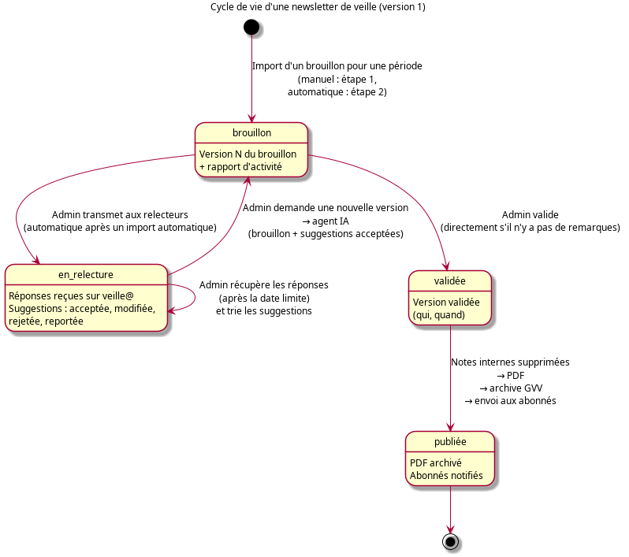

# 20. Newsletter de Veille Sécurité et Réglementation

## Vue d'ensemble

La newsletter de veille réunit, pour une période donnée (en général deux mois), les informations de sécurité et de réglementation utiles au club : publications EASA, BEA, DSAC, fédérations, consignes de navigabilité, accidents et incidents…

Elle est produite par deux systèmes qui échangent des fichiers :

- **l'agent de rédaction**, un agent IA qui explore les sources, rédige le brouillon d'une période puis ses versions successives (voir §1) ;
- **GVV**, où l'administrateur importe les brouillons, les annote, les fait relire par email, trie les remarques, produit les consignes de modification pour l'agent, puis valide, archive et envoie la newsletter (voir §2 et §3).

Rien n'est envoyé sans une action de l'administrateur : l'agent n'envoie aucun email, et chaque étape du cycle est déclenchée depuis GVV.

**Rôle requis** : administrateur du club (`club-admin`) pour la gestion ; membre actif pour la consultation de l'archive
**Menus** :
- `Administration > Veille réglementaire` — éditions et cycle de relecture (`/newsletter_admin/editions`)
- `Administration > Abonnement à la newsletter` — abonnés (`/newsletter_admin`)
- `Membres > Newsletters` — archive des newsletters publiées (`/newsletter`)
- `Dev > Newsletter — Configuration` et pages de test (`/newsletter_admin/configuration`)

> La fonctionnalité est activée par `$config['veille'] = true;` dans `application/config/program.php`. Sans ce réglage, les menus sont masqués et les pages répondent « introuvable ».



---

## 1. Contrôle de l'agent de rédaction

> **À compléter** : commandes acceptées par l'agent, avec leur effet et leurs paramètres.

L'agent de rédaction produit :

- la **version initiale** du brouillon d'une période, à partir de ses sources et, le cas échéant, des remarques reportées par les éditions précédentes (§2.8) ;
- une **version suivante**, à partir des consignes de modification téléchargées dans GVV (§2.6).

Il doit respecter le format de brouillon décrit au §2.1 pour que GVV puisse l'importer.

---

## 2. Gestion de la veille dans GVV

Une **édition** correspond à une période. Son cycle commence hors de GVV, par la **génération du brouillon initial** (v1) par l'agent IA (§2.1). Une fois ce brouillon importé, l'édition contient les versions successives du brouillon (v1, v2…) et passe par les états suivants :

| État | Signification | Actions possibles |
|------|---------------|-------------------|
| **Brouillon** | Version importée, pas encore transmise (ou nouvelle version après un tour de relecture) | Annoter, transmettre aux relecteurs, télécharger les consignes de modification, importer une version suivante, valider et publier, supprimer ; relever les réponses si une version a déjà été transmise |
| **En relecture** | Version transmise aux relecteurs | Relever les réponses, trier les remarques, télécharger les consignes de modification, importer la version suivante |
| **Validée** | Validée, mais la publication n'a pas abouti | Relancer la publication |
| **Publiée** | Archivée pour les membres et envoyée aux abonnés | Consulter le PDF publié ; renvoyer aux abonnés non atteints |

La page de l'édition affiche toujours, sous **Étape suivante**, ce qu'il reste à faire et les boutons correspondants.

Le déroulé complet d'une édition :

```
 Agent           GVV (administrateur)                       Relecteurs
 ─────           ────────────────────                       ──────────
 2.1 Génération
     du brouillon
     initial
 v1 ──────────▶  2.2 Import ─▶ 2.3 Annotation
                 2.4 Transmission ─────────────────────────▶ lecture du PDF
                 2.5 Relevé des réponses ◀──────────────────  réponses par email
                     Tri des remarques
 v2 ◀──────────  2.6 Consignes de modification
 v2 ──────────▶  2.7 Import de la version suivante ─▶ annotation ─▶ nouveau tour…
                 2.9 Valider et publier ─▶ archive membres + envoi aux abonnés
```

### 2.1 Génération du brouillon initial

L'agent de rédaction produit le brouillon de la période (voir §1). Le brouillon est :

- soit un fichier **Markdown** (`.md`) ;
- soit une **archive zip** contenant un seul fichier Markdown et le sous-répertoire des images qu'il référence (par exemple `img/planeur.svg`).

GVV lit trois informations dans le Markdown :

| Donnée | Repère attendu | Exemple |
|--------|----------------|---------|
| **Titre** | Premier titre de niveau 1 | `# Veille sécurité et réglementation – octobre 2026` |
| **Période** | Ligne « Période : du … au … », dates en toutes lettres ou numériques (l'année du début peut être omise) | `Période : du 21 septembre au 21 octobre 2026` |
| **Version** | Mention « BROUILLON vN » | `BROUILLON v1` |

Le brouillon peut aussi contenir des **notes internes**, destinées au CPS et aux relecteurs, qui seront retirées automatiquement à la publication :

| Note interne | Forme |
|--------------|-------|
| Section interne | Titre contenant « SECTION INTERNE », jusqu'au titre suivant de même niveau |
| Zones délimitées | `<!-- INTERNE -->` … `<!-- /INTERNE -->` ou `<!-- BROUILLON -->` … `<!-- /BROUILLON -->` |
| Avertissement de brouillon | Citation commençant par `> **BROUILLON` |
| Notes de rédaction | Texte entre doubles accolades `{{ … }}` |

Les **mentions entre crochets** (`[à compléter]`, `[date à confirmer]`…) signalent une information manquante. Elles ne sont pas retirées : GVV les liste pour qu'elles soient complétées avant la validation (§2.9).

### 2.2 Import du brouillon

`Administration > Veille réglementaire` > **Importer un brouillon** : choisissez le fichier `.md` ou `.zip` (30 Mo au plus), puis **Importer**. Une archive est refusée si elle contient plus de 300 fichiers, si son Markdown dépasse 2 Mo, si une image dépasse 10 Mo ou si son contenu décompressé dépasse 60 Mo.

- Si aucune édition non publiée ne porte la même période, une **nouvelle édition** est créée à l'état Brouillon.
- Sinon, le brouillon devient la **version suivante** de cette édition (voir §2.7).

L'import est refusé, avec un message indiquant le repère attendu, si le titre, la période ou la version est introuvable, si l'archive contient plusieurs fichiers Markdown ou aucun, si la version est déjà importée, ou si l'édition de la période est déjà validée. Une image référencée mais absente de l'archive est signalée : l'import réussit, mais l'image ne sera pas affichée.

### 2.3 Annotation par l'administrateur

La page de l'édition affiche le **brouillon annoté**, découpé en passages (paragraphes, listes, titres, citations). Pour ajouter un commentaire :

1. Cliquez sur **Commenter** sous le passage concerné.
2. Gardez ou modifiez le **libellé** (« Commentaire du DTO » par défaut) et saisissez le **commentaire**.
3. Cliquez sur **Insérer le commentaire**.

Le commentaire apparaît sous le passage, dans un encadré « **Libellé :** texte ». Il figure dans le PDF transmis aux relecteurs et dans les consignes de modification. L'icône de suppression le retire.

Un commentaire est attaché à une version : il ne passe pas à la version suivante, c'est l'agent qui l'intègre dans son texte à partir des consignes de modification.

**Aperçu PDF** montre le brouillon tel que les relecteurs le recevront. Les liens **Versions** (v1, v2…) affichent chaque version et ses différences avec la précédente.

### 2.4 Transmission aux relecteurs

Bouton **Transmettre la vN aux relecteurs (n)**, où n est le nombre de relecteurs configurés.

Chaque relecteur reçoit un email avec le brouillon annoté en PDF et la date limite de réponse (voir §3 pour le contenu de l'email et la configuration). Le message de confirmation liste les destinataires effectivement atteints et ceux en échec. L'édition passe **En relecture** ; si aucun email n'a pu partir, elle reste à l'état Brouillon.

Pour une version qui n'a pas besoin de relecture, passez directement au §2.9.

### 2.5 Relevé et tri des remarques

**Relever les réponses** (page de l'édition, ou liste des éditions) lit la boîte de veille et enregistre chaque réponse d'un relecteur comme une **remarque**, avec ses pièces jointes. Un compte rendu indique le nombre de messages lus, de réponses retenues et de réponses écartées avec leur motif (voir §3.3). Le relevé peut être relancé autant de fois que nécessaire : une réponse déjà enregistrée n'est pas reprise. Tant que la date limite n'est pas atteinte, la page rappelle que d'autres réponses peuvent arriver.

Dans la section **Remarques des relecteurs**, attribuez une décision à chaque remarque puis cliquez sur **Enregistrer** :

| Décision | Effet |
|----------|-------|
| **Acceptée** | Transmise à l'agent pour être appliquée (statut `APPLIQUER`) |
| **Modifiée** | Transmise à l'agent avec **votre** texte, saisi dans « Texte retenu » (obligatoire) ; le texte du relecteur est cité pour mémoire |
| **Rejetée** | Non transmise à l'agent |
| **Reportée à une prochaine édition** | Transmise avec le statut `REPORTER`, puis proposée aux éditions suivantes (§2.8) |
| **En attente** | Pas encore triée ; le nombre de remarques sans décision est rappelé sur la page |

Les pièces jointes d'une remarque sont téléchargeables depuis la remarque.

### 2.6 Consignes de modification pour l'agent

Bouton **Consignes de modification (n commentaire(s), n remarque(s))**. Le fichier téléchargé contient, pour la version courante :

- les **commentaires** de l'administrateur, avec le début du passage sous lequel ils sont insérés — statut `APPLIQUER` ;
- les remarques **acceptées** ou **modifiées** du tour — statut `APPLIQUER` ;
- les remarques **reportées** du tour — statut `REPORTER` ;
- l'auteur et les images de chaque remarque.

Les remarques rejetées n'y figurent pas. Le fichier est un Markdown, ou une archive zip avec un sous-répertoire `img/` s'il y a des images. Il est nommé d'après la période et la version, par exemple `consignes_modification_20260921-20261021_v1.zip`.

Fournissez ce fichier à l'agent de rédaction (voir §1) : il produit la version suivante.

### 2.7 Import de la version suivante et nouveau tour

Importez la nouvelle version comme au §2.2 (**Importer la version suivante** sur la page de l'édition). Elle est rattachée à l'édition de même période, remplace la version courante (les précédentes restent consultables) et remet l'édition à l'état **Brouillon**.

À partir de là, deux choix :

- un **nouveau tour de relecture** : annotation (§2.3), puis transmission (§2.4) — le compteur « Tour de relecture » augmente ;
- la **validation** (§2.9), si la version convient.

### 2.8 Remarques reportées

Une remarque reportée reste rattachée à son édition. Elle est ensuite proposée dans les autres éditions, sous **Remarques reportées par d'autres éditions** : **Reprendre dans cette édition** la rattache à l'édition courante, en attente d'une nouvelle décision.

Pour préparer la version initiale d'une nouvelle période, le bouton **Remarques reportées (n)** de la liste des éditions télécharge l'ensemble des remarques reportées, à fournir à l'agent.

### 2.9 Validation

Bouton **Valider et publier la vN**, disponible à l'état Brouillon, avec ou sans tour de relecture.

Avant de cliquer :

- vérifiez la liste des **mentions entre crochets** restant à compléter, affichée sur la page ; elle est rappelée dans la demande de confirmation ;
- vérifiez l'**Aperçu PDF**.

La validation enregistre la date et l'auteur, et enchaîne immédiatement la publication (§2.10). Une édition validée ne peut plus recevoir de nouvelle version.

### 2.10 Finalisation, archivage et envoi

La publication, déclenchée par la validation :

1. retire les **notes internes** (§2.1), sans réécriture du texte : le texte diffusé est exactement le texte validé, notes en moins ;
2. ajoute en fin de newsletter la mention « *Validé le jj/mm/aaaa par Prénom Nom* » ;
3. produit le **PDF mis en page** (bandeau de titre, rubriques, encadrés, images) ;
4. dépose le PDF dans l'**archive des membres** ;
5. l'**envoie par email** à tous les abonnés confirmés, avec un message personnalisé, une invitation à signaler les informations manquantes et un lien de désabonnement.

Le message de confirmation indique le nombre d'abonnés atteints et donne le lien vers le PDF. Si la publication échoue avant l'envoi, l'édition reste **Validée** et le bouton **Relancer la publication** permet de recommencer.

Si l'envoi échoue pour certains abonnés (serveur d'envoi indisponible, adresse refusée, envoi interrompu), le message liste les adresses non atteintes et la page de l'édition publiée indique leur nombre. Une fois la cause corrigée, **Renvoyer aux abonnés non atteints (n)** envoie la newsletter à ces seuls abonnés : ceux qui l'ont déjà reçue ne la reçoivent pas deux fois, et les abonnés inscrits après la publication ne sont pas concernés, sauf pour le dernier numéro paru : ils le reçoivent à la confirmation de leur abonnement, et ceux pour qui cet envoi a échoué font partie des abonnés non atteints.

### 2.11 Abonnés et archive

**Abonnés** — `Administration > Abonnement à la newsletter` liste les abonnés (nom, email, date, statut) et permet d'en supprimer. Cette page donne aussi le lien de la **page publique d'abonnement** (`/newsletter_public/subscribe`), à diffuser : un visiteur y saisit son nom et son email, puis confirme par le lien reçu. À la confirmation, il reçoit par email le dernier numéro paru ; la page de confirmation lui indique si l'envoi a réussi. Chaque newsletter envoyée contient un lien personnel de désabonnement.

**Archive** — `Membres > Newsletters` liste, pour les membres actifs connectés, les newsletters publiées (titre, période, date de publication) ; **Ouvrir** affiche le PDF.

**Suppression** — un administrateur peut supprimer une édition, quel que soit son état, depuis la liste des éditions, la page d'une édition en brouillon ou l'archive. La suppression efface ses versions, commentaires, remarques, le journal des envois et, pour une newsletter publiée, son PDF. Elle est définitive.

---

## 3. Relecture par email

### 3.1 Configuration

`Dev > Newsletter — Configuration` :

| Réglage | Rôle |
|---------|------|
| **Boîte mail de collecte (IMAP)** | Boîte de veille où arrivent les réponses des relecteurs |
| **Serveur d'envoi (SMTP)** et **Adresse d'expédition** | Compte utilisé pour la transmission et la diffusion ; vide = configuration SMTP globale de GVV |
| **Relecteurs** | Adresses autorisées à répondre, séparées par des virgules |
| **Délai de réponse des relecteurs (jours)** | Sert à calculer la date limite indiquée dans l'email (2 jours par défaut) |
| **Sujet** et **Corps de l'email de relecture** | Modèle de l'email de transmission |

Variables utilisables dans le sujet et le corps : `{period}` (période), `{version}`, `{date}` (date d'envoi), `{deadline}` (date limite), `{from_name}` (nom affiché de l'expéditeur), `{draft_name}` (titre de l'édition).

Les pages `Newsletter — Test envoi email` et `Newsletter — Test IMAP` du menu Dev vérifient que l'envoi et la lecture de la boîte fonctionnent.

### 3.2 L'email de transmission

Chaque relecteur reçoit un email :

- envoyé depuis l'adresse d'expédition, qui est aussi l'adresse de réponse ;
- dont le sujet est celui du modèle, suivi d'une **référence** de l'édition et de la version, par exemple `[NL-12 v2]` ;
- avec en pièce jointe le brouillon annoté en PDF (`Veille_brouillon_v2.pdf`) ;
- qui indique la date limite de réponse et demande de signaler toute information manquante avec sa source.

### 3.3 Ce que les relecteurs doivent faire

Les relecteurs **répondent à l'email reçu** (bouton « Répondre » de leur messagerie) :

- en **gardant le sujet**, qui contient la référence `[NL-… v…]` : c'est elle qui rattache la réponse à l'édition ;
- depuis l'**adresse configurée comme relecteur** ;
- de préférence **une réponse par sujet**, ce qui facilite le tri : chaque réponse devient une remarque distincte ;
- en joignant si besoin des images ou documents (10 Mo au plus par pièce jointe).

Le texte cité du message d'origine est retiré automatiquement de la remarque.

Une réponse tardive, arrivée après l'import ou la transmission d'une version suivante, est relevée normalement : elle rejoint les remarques du tour en cours, car elle reste en général valable pour la nouvelle version. Les réponses ne sont plus relevées une fois l'édition validée.

### 3.4 Réponses écartées

Lors du relevé (§2.5), une réponse n'est pas enregistrée dans les cas suivants :

| Motif | Cause | Que faire |
|-------|-------|-----------|
| *sans rapport avec cette édition* | Le sujet ne contient pas la référence de l'édition (sujet modifié, nouveau message) | Demander au relecteur de répondre à l'email de transmission, sujet inchangé |
| *déjà récupérée* | Réponse déjà enregistrée lors d'un relevé précédent | Aucune action |
| *expéditeur non autorisé* | L'adresse d'envoi ne figure pas dans la liste des relecteurs | Ajouter l'adresse dans la configuration, puis relever à nouveau |
| *réponse vide* | Ni texte (hors citation) ni pièce jointe | Aucune action |

Toutes les réponses écartées sont listées dans le compte rendu du relevé, avec leur motif, sauf celles sans rapport avec l'édition.

---

## 4. Dépannage

| Symptôme | Cause probable | Solution |
|----------|----------------|----------|
| « Aucun relecteur configuré » à la transmission | Liste des relecteurs vide | Renseigner les relecteurs (§3.1) |
| « Adresse d'expédition non configurée » | SMTP de la newsletter incomplet | Renseigner l'adresse d'expédition (§3.1) |
| « Lecture de la boîte de veille impossible » | Paramètres IMAP erronés ou serveur injoignable | Vérifier avec `Dev > Newsletter — Test IMAP` |
| Une réponse attendue n'apparaît pas | Sujet modifié, adresse non autorisée, ou réponse arrivée dans un autre dossier IMAP | Consulter le compte rendu du relevé (§3.4) et le dossier IMAP configuré |
| « La version N est déjà importée » | L'agent a produit un brouillon sans changer la mention « BROUILLON vN » | Faire produire une version supérieure par l'agent |
| « L'édition … est déjà validée » | Import d'une version pour une période déjà validée | Une édition validée ne reçoit plus de version ; vérifier la période du brouillon |
| L'édition reste « Validée » | La publication a échoué (écriture du PDF) | Corriger la cause indiquée, puis **Relancer la publication** |
| « échec pour n abonné(s) » après la publication | Serveur d'envoi indisponible, adresse refusée, envoi interrompu | Corriger la cause, puis **Renvoyer aux abonnés non atteints** sur la page de l'édition |
